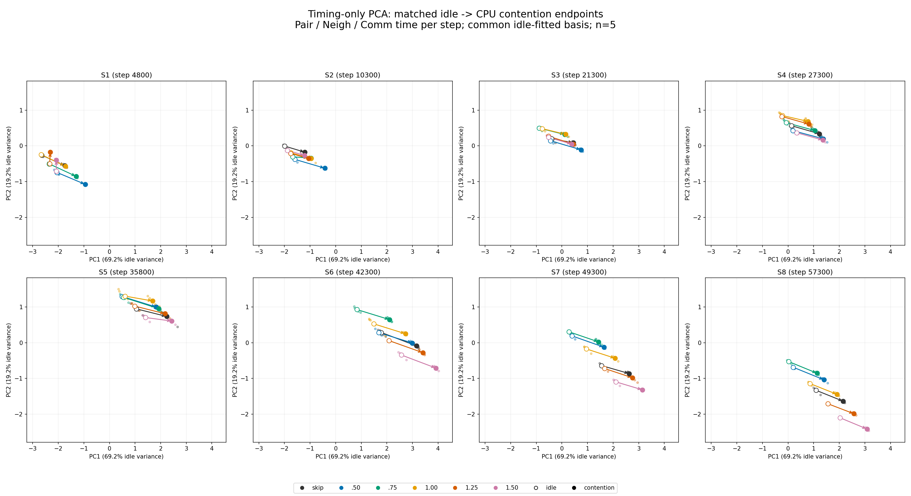
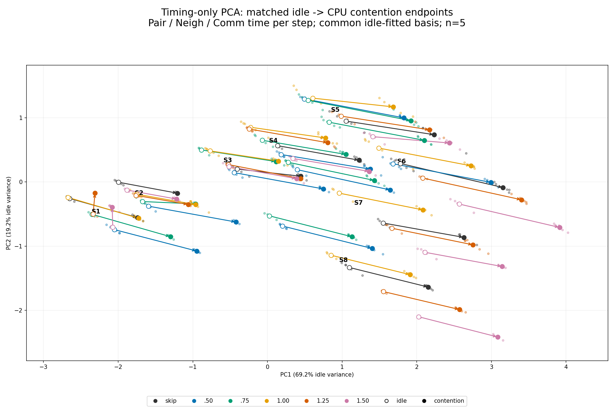
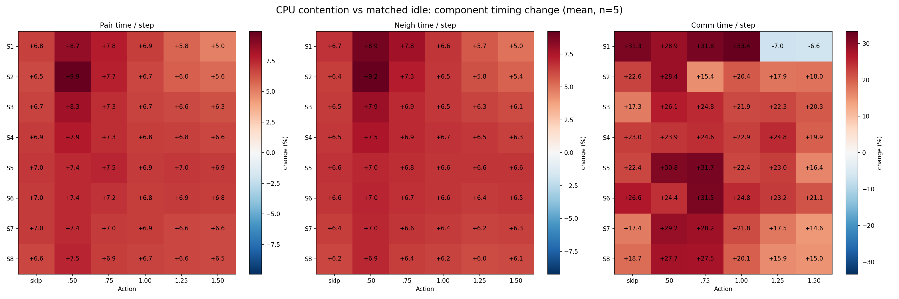

# 性能に関する次状態の条件間比較

不均衡を除き、Pair・Neigh・Commの1 stepあたり時間だけを使用。保存済み480試行（8 checkpoints × 6 actions × 各負荷5反復）から生成。追加実験なし。

PCAはidle240終点で標準化・fitし、contentionにも同じ変換を適用。中空円がidle、塗りつぶしがcontention、小さい点が各反復。矢印は同一checkpoint/actionのidle終点平均→contention終点平均であり、MDの時間遷移を示す矢印ではない。前の図のheuristic参照始点はここでは使っていない。

同一状態からactionを適用して500 steps進めた結果の性能指標を条件間で比較する。実際の再構成直後pre-action timingを共通条件で記録していないため、厳密なpre→post変化量の条件差は算出できない。各時間は500-step区間で集計された値であり、瞬間値ではない。

変化率は100×(contention mean / idle mean − 1)。[compact CSV](performance_state_comparison.csv)に各条件mean、反復blockを対応させた差、無補正df4 tの95% CIを保存。144比較の同時保証ではない。測定は再開を挟んで10月8–9日にまたがるため時間変動も含む。不均衡3指標はログ精度で一致するが、性能指標の終点はcontentionで変化する。

[係数と入力SHA-256](performance_pca_metadata.json)
