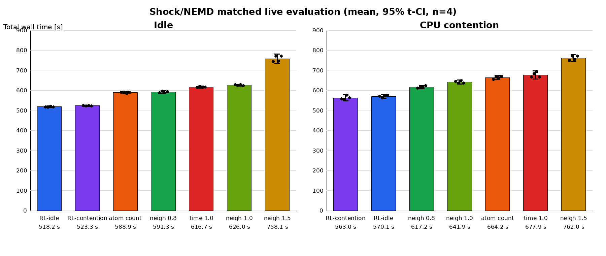

# ampb：RL対公式balance方式

学習96 episode・評価56 episodeを完了。既存解析の描画範囲をユーザー承認のうえ修正し、PNGとcompact CSVの生成も完了した。実験コード・方策・測定条件は変更していない。

## 条件と環境

commit `26e9bbb5e227c41f8d161ed31764c373ce119a0d`。MPI32 / OMP1、491,520 atoms、skin0.5、500 steps × 120 decisions。学習は各方策48 episode（20 exploration + 28 online-FQI）。評価は未学習seed47287/57287 × 2反復 × idle/contention。schedule seed20261008、contention cores0–7、2–5 decisionsのON/OFF。評価中は既存の凍結モデルを使用。

Ubuntu26.04.1、Xeon6972P×2、192物理core、6 NUMA、1.5TiB RAM、GCC15.2、CMake4.2.3、OpenMPI5.0.10（/opt/openmpi）。Release、MPI/OMP/OPENMP/SHOCK ON、-march=native、build jobs16。承認された設定差はEXTRA-PAIR/EXTRA-COMPUTE追加とMPIインストール選択。旧buildを保存。binary SHA-256 `800599e36d1865f5ce5ff8ead25629e93e09ede25b7726b78f881159970647b0`。

## 完全性・安全性

- 学習idle：48 episodes / 5,760 transitions、全process exit0、unsafe0、dangerous0、原子数・step異常0。
- 学習cpu_jitter：48 episodes / 5,760 transitions、全process exit0、unsafe0、dangerous0、原子数・step異常0。
- 評価：56/56 episodes、6,720 transitions、全exit0、dangerous0、原子数・step異常0、reward finite。
- 完了確認時、残留MPI/LAMMPS processなし。初期restart生成の既存入力はdangerous builds not checkedであり、0とは解釈しない。

## 各方式の統計

95% CIはn=4のt区間（df3）。同一マシン内のpaired比較を主結果とし、amp2との差は参考値。複数比較補正なし。

|regime|方策|順位|mean s|sample SD|CV %|95% CI|
|---|---|---:|---:|---:|---:|---|
|idle|RL-idle|1|518.203|2.401|0.463|[514.381, 522.024]|
|idle|RL-contention|2|523.308|1.286|0.246|[521.262, 525.354]|
|idle|neigh 0.8|4|591.341|4.301|0.727|[584.497, 598.184]|
|idle|neigh 1.0|6|625.990|2.878|0.460|[621.410, 630.570]|
|idle|neigh 1.5|7|758.103|14.714|1.941|[734.690, 781.516]|
|idle|atom count|3|588.863|2.796|0.475|[584.414, 593.312]|
|idle|time 1.0|5|616.657|2.745|0.445|[612.289, 621.025]|
|jitter|RL-idle|2|570.091|5.194|0.911|[561.826, 578.356]|
|jitter|RL-contention|1|563.034|9.480|1.684|[547.949, 578.120]|
|jitter|neigh 0.8|3|617.198|5.180|0.839|[608.956, 625.441]|
|jitter|neigh 1.0|4|641.875|6.307|0.983|[631.839, 651.910]|
|jitter|neigh 1.5|7|761.978|11.319|1.485|[743.967, 779.988]|
|jitter|atom count|5|664.202|6.903|1.039|[653.217, 675.187]|
|jitter|time 1.0|6|677.871|12.730|1.878|[657.615, 698.126]|

## Paired比較

差は公式−RL（正ならRLが速い）。対応単位はphysical seed × repeat。各regimeの平均で最良方式を選ぶため、選択後の記述的比較であり独立な選択評価ではない。

|regime|比較|paired mean差 s|95% CI|平均短縮率 %|
|---|---|---:|---|---:|
|idle|atom count − RL-idle|70.661|[62.426, 78.895]|12.000|
|jitter|neigh 0.8 − RL-contention|54.164|[37.104, 71.224]|8.776|

## RLのbalance率・factor分布

|regime|方策|balance率 %|factor mean|factor sample SD|
|---|---|---:|---:|---:|
|idle|idle_trained|87.500|0.70751|0.33857|
|idle|jitter_trained|81.042|0.82883|0.37295|
|jitter|idle_trained|87.500|0.70579|0.33731|
|jitter|jitter_trained|81.458|0.83086|0.36999|

## amp2との参考比較

|regime|方策|amp2 mean s|ampb mean s|変化 %|
|---|---|---:|---:|---:|
|idle|RL-idle|787.784|518.203|-34.220|
|idle|RL-contention|817.844|523.308|-36.014|
|idle|neigh 0.8|824.130|591.341|-28.247|
|idle|neigh 1.0|831.839|625.990|-24.746|
|idle|neigh 1.5|895.980|758.103|-15.388|
|idle|atom count|947.193|588.863|-37.831|
|idle|time 1.0|975.228|616.657|-36.768|
|jitter|RL-idle|922.112|570.091|-38.175|
|jitter|RL-contention|913.976|563.034|-38.397|
|jitter|neigh 0.8|955.671|617.198|-35.417|
|jitter|neigh 1.0|944.029|641.875|-32.007|
|jitter|neigh 1.5|971.585|761.978|-21.574|
|jitter|atom count|1143.080|664.202|-41.894|
|jitter|time 1.0|1110.758|677.871|-38.972|

各hostで別々に再学習しているため、host性能と学習された方策の違いを切り分ける比較ではない。

## 解析停止の理由

analyze_rl_vs_official.pyのplot()は縦軸を740–1180秒に固定する。ampbのmeanが740秒未満だと矩形のy座標が逆転し、Pillowが `ValueError: y1 must be greater than or equal to y0` を出す。pipeline exit1。summary/action stats compact CSVは生成済み。当初は独断修正禁止の指示に従い停止した。その後ユーザー承認を受け、共通縦軸を0始点、全実測値と95% CIを含む上限に修正。既存解析を再実行して終了コード0でPNG生成を確認した。全学習・評価は解析エラーの前に完了しており、追加実験は不要。

[統計CSV](rl_vs_official_summary.csv)、[action統計CSV](rl_vs_official_action_stats.csv)。生データ・restart・binary・checkpoint・巨大logはGit追加していない。
