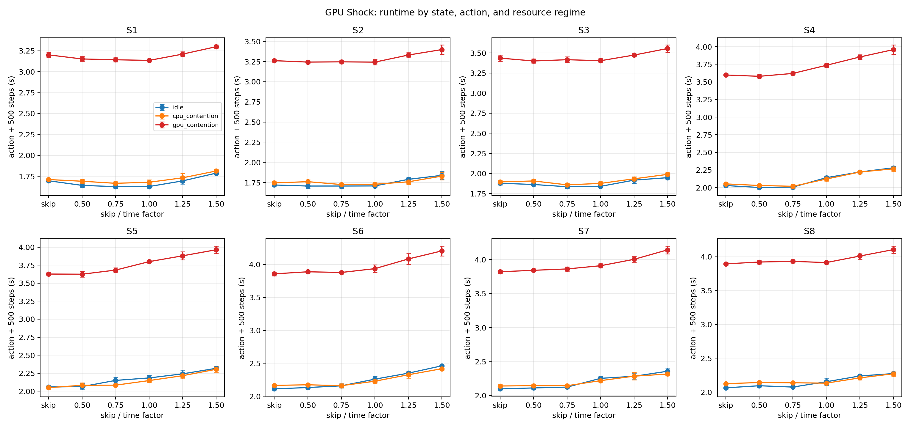
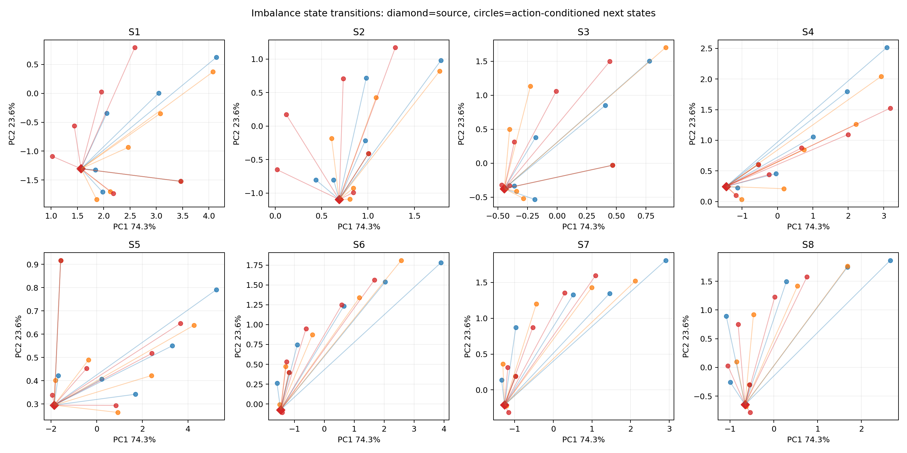
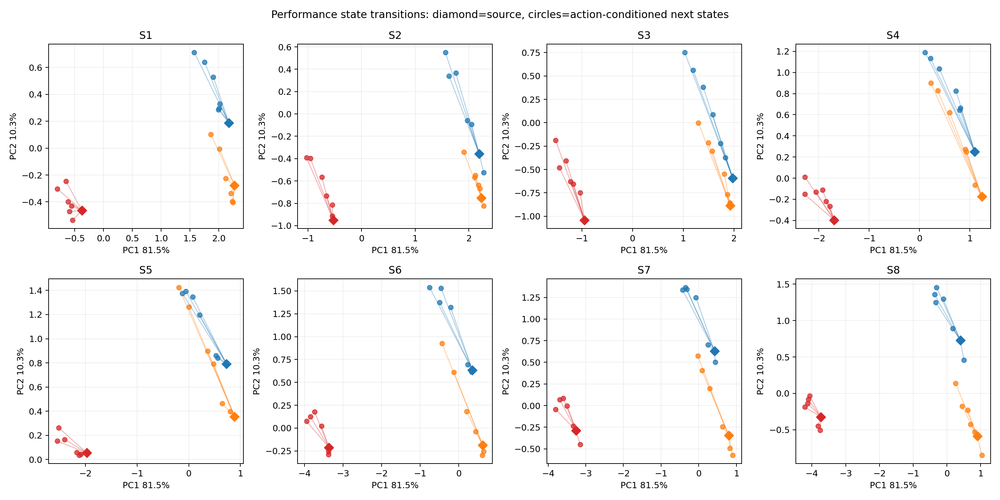

# 2026-10-12 amp2：GPU Shock/NEMDの状態・行動・外部負荷調査

## 実験の位置づけ

本実験は、[2026-10-07のCPU反実仮想実験](../2026-10-07_amp2/README.md)と同じく、
同一のShock/NEMD内部状態からactionを分岐し、次を測定した。

1. actionが次の不均衡状態・性能状態を変えるか
2. idle、CPU contention、GPU contentionで報酬応答が変わるか
3. resource stateによって最良actionが変わるか

方策学習ではなく、`T(s,a)`と`P(s'|s,a)`を直接測るcharacterizationである。

## 環境とGPU-native workload

- マシン：amp2、Intel Xeon Gold 6240R ×2、48物理core
- GPU：RTX 3090 ×4
- CUDA：13.4.59、driver 615.71.09
- MPI：Open MPI 5.0.10、CUDA-aware MPIなし
- LAMMPS：`build_shock_kokkos_cuda/lmp`
- 実行：MPI 32、OpenMP 1、4 GPUs、8 ranks/GPU、CUDA MPS
- KOKKOS：`-k on g 4 -sf kk -pk kokkos gpu/aware off`
- workload：Shock/NEMD、`nx=480, ny=nz=16`、491,520原子、seed 47287
- neighbor：skin 0.5、`every 1 delay 0 check yes`
- 1区間：500 MD steps

CPU生成restartをKOKKOSへ持ち替えると後期checkpointでlost atomsが発生したため、
初期化、軌跡、代表checkpoint、action forkをすべてGPU backendで作り直した。GPU-native
restartは500-step smokeを正常終了し、本測定720試行も全件正常終了した。

## CPU版からの必要なaction変更

CPU版の`weight neigh factor`はKOKKOS GPUでは利用できない。LAMMPS
`src/imbalance_neigh.cpp`がGPU使用時に明示的に処理をskipし、実際に
`Balance weight neigh skipped with KOKKOS using GPUs`が出た。

GPU版では、KOKKOSでも有効で、直前区間のPair・Neigh・Bond・KSpace時間をrank負荷へ
変換する`weight time`を使用した。

| Action | 実行内容 |
|---|---|
| skip | balanceを実行しない |
| time 0.50 | `balance 1.0 shift x 10 1.0 weight time 0.50` |
| time 0.75 | 同factor 0.75 |
| time 1.00 | 同factor 1.00 |
| time 1.25 | 同factor 1.25 |
| time 1.50 | 同factor 1.50 |

したがってCPU版と実験構造は同じだが、actionの意味は同一ではない。CPU版の
`weight neigh`結果とGPU版の`weight time`結果を直接的なbackend比較として扱わない。

## State、遷移、報酬

各独立processでGPU-native checkpointを読み、atom-count balanceで共通partitionを
再構成した。そのresource regime下で共通500-step probeを実行し、その終了状態を
厳密なaction前状態`s_t`とした。probe直後にactionを適用し、さらに500 steps進めて
`s_{t+1}`と報酬を測定した。`weight time`がprobe timingを利用できるよう、probeと
balanceの間にtimingを消去する`run 0`は入れていない。

```text
GPU-native checkpoint
  -> 共通atom-count partition
  -> resource regime下で500-step probe
  -> s_t
  -> skip または weight time factor
  -> 500 steps
  -> s_{t+1}, reward
```

状態は解析上、次の二群へ分けた。

### 粒子・分割不均衡状態

- atom不均衡：`Nlocal_max / Nlocal_mean`
- neighbor不均衡：`FullNghs_max / FullNghs_mean`
- ghost不均衡：`Nghost_max / Nghost_mean`
- 各量のrank平均・最大・最小

KOKKOSはfull neighbor listを使用するため、通常の`Neighs`は0であり、実際のneighbor
entry数は`FullNghs`として出力される。parserではGPU時にこれを論理的な`neighs`へ
対応付けた。

### 性能状態

- 直前500 stepsのPair、Neigh、Comm、Modify、Other時間/step
- neighbor build回数
- probe wall time
- GPU utilization、memory utilization、power、clock、temperature、memory使用量

物理量（temperature、pressure、density、energy、shock位置）も安全確認・解析用に保存
した。報酬はaction適用時間を含む次の500 stepsのwall timeの負値である。

```text
r_t = -(balance action time + 500-step execution time)
```

## Resource regime

- `idle`：意図的co-runnerなし
- `cpu_contention`：LAMMPS rankと重なるCPU 0–7で8 compute workers
- `gpu_contention`：targetが使う4 GPUそれぞれにmedium CUDA co-runnerを1個配置し、
  MPSで直接共有

3 regime × 8 state × 6 action × 5反復の720試行をランダム順で逐次実行した。

## 代表状態

GPU上で公式`fix balance 500 1.2 shift x 10 1.1 weight time 1.0`を120 decisions
×3回実行し、360 transitionsから8状態を選択した。表はaction前の共通probe終了状態。

|State|Step|Atom不均衡|Neighbor不均衡|Ghost不均衡|Idle probe s|
|---:|---:|---:|---:|---:|---:|
|S1|5,800|1.208|1.762|1.346|1.632|
|S2|12,300|1.149|1.585|1.282|1.730|
|S3|20,800|1.188|1.326|1.182|1.862|
|S4|31,300|1.224|1.131|1.079|2.006|
|S5|36,300|1.187|1.066|1.045|2.013|
|S6|45,800|1.142|1.152|1.091|2.132|
|S7|48,300|1.131|1.195|1.110|2.109|
|S8|58,800|1.096|1.332|1.168|2.064|

## Runtime結果



各点は5反復平均、error barは標準偏差。完全な表は
[RUNTIME_MATRIX.md](RUNTIME_MATRIX.md)に保存した。

表示上の最良actionはstateとregimeで変化した。例えばS1はidle/CPUでtime 0.75、GPU
contentionでtime 1.0、S5はidle/CPUでskip、GPU contentionでtime 0.5だった。
しかし大部分のrunner-up差は0.01–0.7%で、cell内CVは概ね0.5–1.7%である。

同じ反復番号でwinnerとrunner-upを比較した無補正95% paired CIでは、明確に0を超えた
のはS6 idleの`skip`対`time 0.5`だけだった（runner-up−winner = 0.02070秒、
95% CI [0.00169, 0.03970]秒）。他のstate/regimeのCIは0を含んだ。したがって、
resource contentionによるbest-action reversalは**候補として観測されたが、5反復で
統計的に確立したとはいえない**。

## Best Fixedとstate-conditioned oracle

|Regime|Best Fixed|8-state total s|記述的oracle s|改善余地|
|---|---|---:|---:|---:|
|idle|time 0.5|15.61499|15.50107|0.730%|
|CPU contention|time 0.75|15.79498|15.74213|0.335%|
|GPU contention|time 0.5|28.65434|28.55592|0.343%|

oracleは同じデータでactionを選択・評価した記述値で、未知stateに対する方策性能では
ない。今回のaction空間における適応余地は1%未満であり、CPU版`weight neigh`実験の
3.45%より小さい。

## 不均衡状態と性能状態の遷移





菱形は各regimeの共通probe終了時`s_t`、丸は各action後`s_{t+1}`の5反復平均。PCAは
可視化のみであり、係数と標準化統計は
[state_transition_pca_metadata.json](state_transition_pca_metadata.json)に保存した。

actionはatom・neighbor・ghost不均衡を明確に変えた。一方、resource regimeは性能状態を
大きく変えた。全状態・actionを等重みで集計したsource probeは、idle 1.943秒、CPU
contention 1.975秒、GPU contention 3.564秒だった。Comm時間/stepは0.001019、
0.001111、0.001663秒となり、GPU contentionの変化は明瞭である。

## 結論

1. Shock内部状態は時間とともに変化し、GPUでも不均衡状態を観測できる。
2. balance actionは次のrank分割・不均衡状態を大きく変える。
3. CPU/GPU contentionは性能状態と報酬を明確に変える。
4. ただし`weight time factor`について、contentionが最良actionを変える証拠は現状弱い。
5. Best Fixedに対するstate-conditioned oracle余地は0.3–0.7%で、RLの主actionとしては
   効果が小さい可能性が高い。

## 安全性と限界

- 720/720試行成功、dangerous build、lost atoms、NaN/Inf、crashは0。
- 1物理seed、1マシン、各cell 5反復。
- GPU contentionは4 GPUすべてへの制御された直接競合で、実クラスタの自然負荷分布
  そのものではない。
- `weight neigh`がGPU非対応のためCPU版とactionは異なる。
- paired CIは各比較について無補正で、全比較を同時保証しない。
- 本結果はcheckpoint条件付き遷移であり、学習方策の訪問分布や長期returnではない。

生データはGit管理外の
`rl_hpc/characterization/data/shock_gpu_state_action_main_v1/`に保存した。
