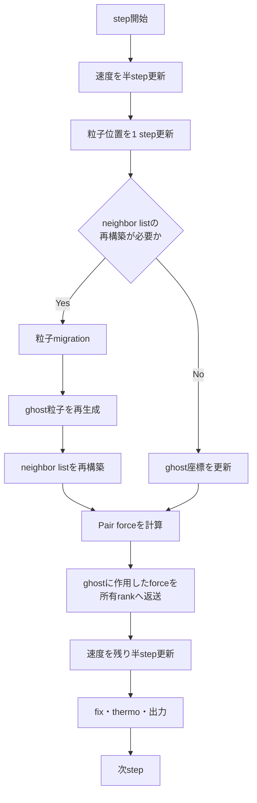
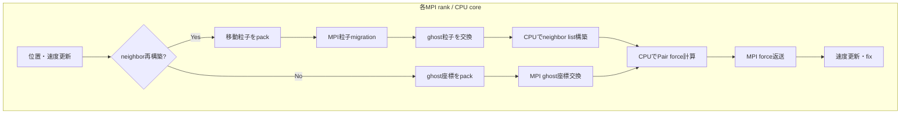
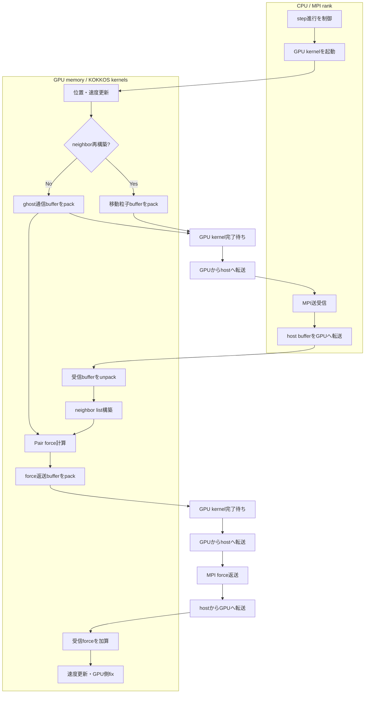
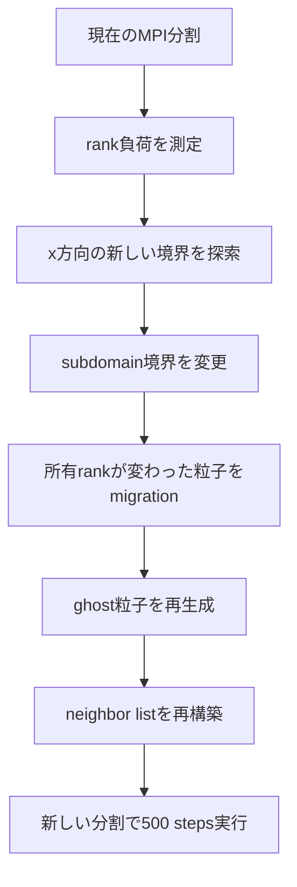
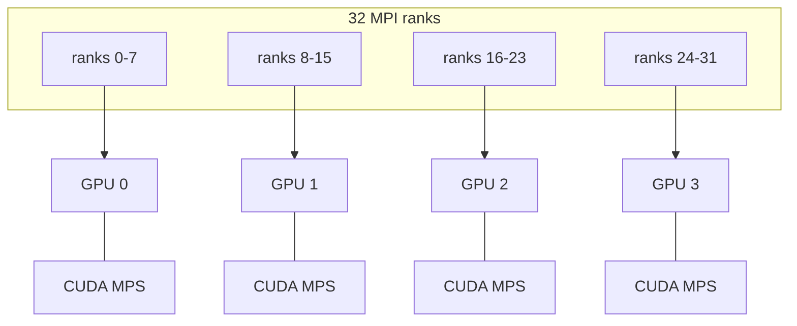
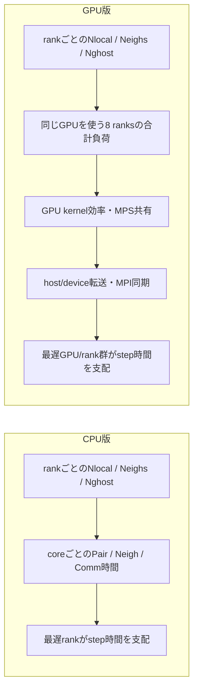
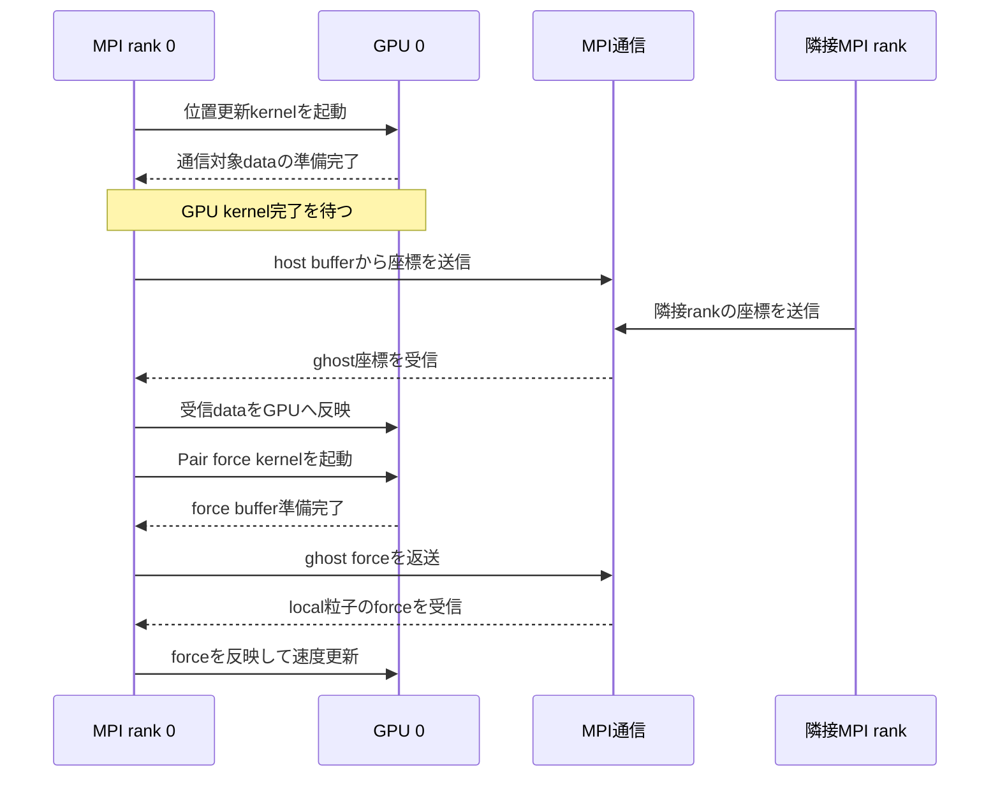
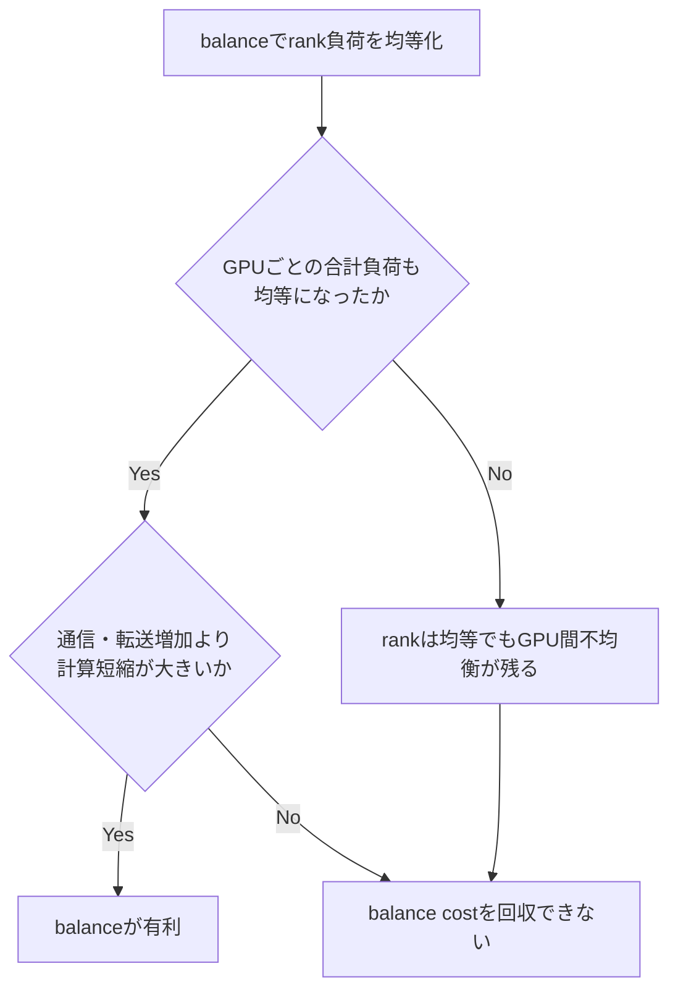

# LAMMPSのCPU版とGPU版におけるMD stepの流れ

## 前提

CPU版とKOKKOS/CUDA版で、velocity-Verletによる物理計算の順序は基本的に同じである。
大きな違いは、処理をCPUとGPUのどちらで実行するか、MPI通信の前後でどこに同期と
memory transferが入るかである。

今回のGPU実験は次の構成である。

- MPI 32 ranks
- RTX 3090 × 4
- 8 ranks/GPU
- CUDA MPS有効
- CUDA-aware MPI無効：`gpu/aware off`

## 共通する1 MD step



物理的には、おおむね次の順序である。

```text
v(t + dt/2)
  -> x(t + dt)
  -> communication / neighbor処理
  -> F(t + dt)
  -> v(t + dt)
```

## CPU版

CPU版では、座標・速度・力・neighbor listの主要データがCPU memoryにあり、各MPI rankが
自身のsubdomainをCPU上で処理する。



rank `i` の代表的な負荷は次の量に依存する。

```text
Pair cost_i  ~ neighbor pair数_i
Neigh cost_i ~ neighbor list構築量_i
Comm cost_i  ~ ghost粒子数_i + subdomain境界面積_i
```

MPI区間の実行時間は、多くの場合、最も遅いrankに支配される。

```text
T_step ~= max_i(T_rank_i) + synchronization overhead
```

## KOKKOS/CUDA版

GPU版でもMPI process自体はCPU上に存在する。CPUがstep進行、MPI通信、GPU kernel起動を
制御し、粒子更新・neighbor list構築・Pair forceなどの対応kernelをGPUで実行する。

今回のOpen MPIはCUDA-awareではないため、MPI通信bufferはhost memoryを経由する。



実装上、すべての処理で必ず図の通り個別copyが発生するとは限らない。しかし
`gpu/aware off`では、MPIが必要とするdevice dataをhost側から送受信できる状態にする
必要があり、GPU kernel、host/device transfer、MPIの間に依存関係と同期が生じる。

## neighbor listを再構築しないstep


このstepでは粒子migration、spatial binの再作成、neighbor listの全再構築を省ける。

## neighbor listを再構築するstep


skinを大きくするとlistに余裕ができ、一般には再構築間隔を延ばせる。一方で各粒子の
候補neighborが増えるため、Pair計算とlist memoryの負担が増える。

```text
大きいskin:
  rebuild回数は減りやすい
  neighbor listは長くなる
  各stepのPair候補数は増える

小さいskin:
  neighbor listは短くなる
  Pair候補数は減る
  rebuildが頻繁になりやすい
```

## balance actionを実行する場合

`balance ... shift x ...`はx方向のMPI subdomain境界を変更する。



balanceが有利になる条件は、action costよりも将来の短縮時間が大きいことである。

```text
balanceが有利
<=>
balance適用コスト
  < balance後に減少する1-step時間 × 効果が続くstep数
```

## 今回の32 MPI ranks / 4 GPU構成

概念的な割当は次の通りである。実際のrank番号とGPUの対応はlauncherのmappingに従う。



CPU版ではrank不均衡が比較的そのままcore間の実行時間差になる。一方、GPU版では
8 ranksの負荷が1 GPU上へ集約される。



## どこで同期するか



主な待ち合わせは次で発生する。

- 粒子migration
- ghost座標のforward communication
- ghost forceのreverse communication
- thermoなどのMPI reduction
- GPU kernelの完了待ち
- host/device transfer
- 同一GPUを共有するrank間のGPU実行待ち

## CPU版とGPU版で最適balanceが一致しない理由

CPU版では、rankごとのneighbor数を均等化することが、Pair計算時間の均等化へ比較的
直接つながる。一方、GPU版ではrank単位の均衡だけでは不十分である。



GPU版ではさらに次が性能へ影響する。

- GPUごとの担当粒子・neighbor pairの合計
- 同一GPUを共有する8 ranks間のkernel投入
- kernelサイズとGPU occupancy
- host/device transfer量
- GPU間・rank間の粒子migration
- CPU側MPI通信との同期
- GPU contention時のMPS共有率、clock、power

したがって、CPUで有効なrank-level balanceがGPUでも最適とは限らない。

## 観測すべき状態

CPU/GPUを共通に比較するには、少なくとも次を残す。

| 層 | 状態候補 |
|:---|:---|
| 物理 | temperature、pressure、density、shock位置 |
| rank分割 | `Nlocal`、`Nghost`、neighbor数のmax/mean |
| CPU性能 | Pair、Neigh、Comm時間、rank timing imbalance |
| GPU集約 | GPUごとの担当`Nlocal`・neighbor数・ghost数の合計 |
| GPU性能 | utilization、power、clock、kernel時間、memory使用量 |
| 通信 | migration量、ghost交換量、host/device転送時間 |

特にGPU実験では、rank単位の不均衡だけでなく、rankをGPU単位に集約した不均衡を
状態として扱う必要がある。
