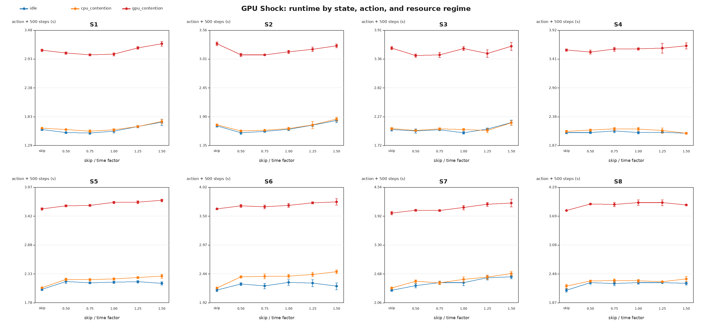
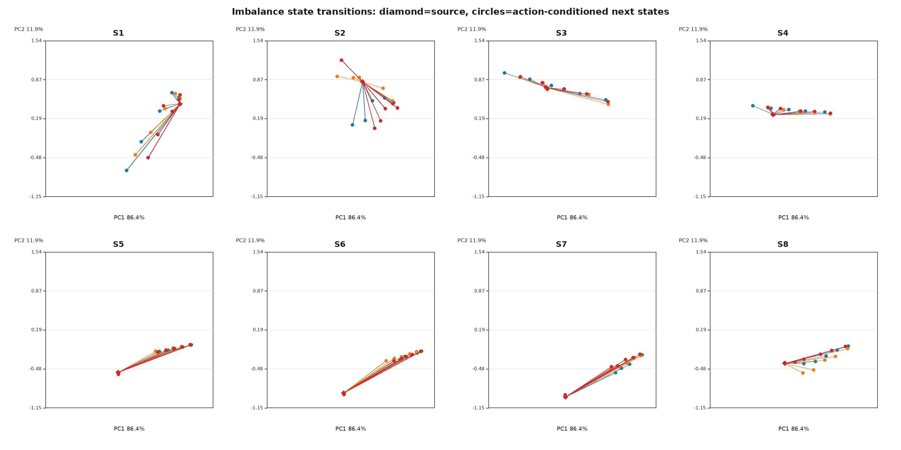
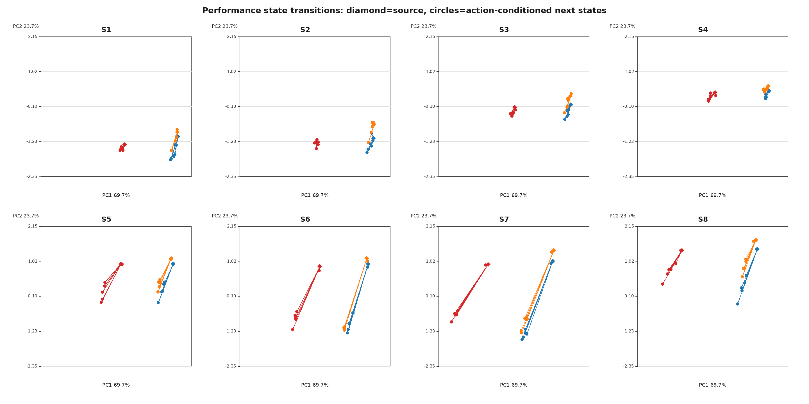

# 2026-10-13 amp2：GPU Shock/NEMDの高不均衡状態におけるstate × action調査

## 実験の位置づけ

- 実施日：2026-10-13（Asia/Tokyo）
- マシン：`amp2.g2.gsic.titech.ac.jp`（amp2）
- LAMMPS基準コミット：`c8bd2ae5927ee236a8892dbd51c18a92cc9c33cf`
- 実験コードのgit commit：`dfd37932149c4383263d00eb84fde852d08a8532`

本実験では、GPU版Shock/NEMDで意図的に動的load balanceを行わず、不均衡が
大きくなる軌跡を作った。その軌跡から8個の代表状態を保存し、同じ状態から
6種類のbalance actionへ分岐して、次の2点を調べた。

1. simulationの進行に伴い、最良actionが変化するか
2. idle、CPU contention、GPU contentionによって最良actionが変化するか

これは学習実験ではない。同じ物理状態・同じMPI領域分割から複数actionを試す
反実仮想実験であり、直接測定したのは `T(s,a)` と `s -> s'` である。

## 結論の要約

- **状態による明瞭なaction reversalが確認された。** S1–S4ではbalance実行が最良、
  S5–S8では3つすべてのresource regimeで`skip`が最良だった。
- **idleとCPU contentionの最良actionはほぼ同じだった。** S3のfactor値だけ異なるが、
  1位と2位の差が0.11%しかなく、意味のある差とは断定できない。
- **GPU contentionではbalance factorの好みが変わる候補が見えた。** S3とS4では
  idleの最良値が1.0、1.5なのに対し、GPU contentionではともに0.5だった。ただし、
  runner-upとの差は0.41%、0.98%なので追加確認が必要である。
- 8状態を通じたBest Fixedは、idle/CPU contentionでは`skip`、GPU contentionでは
  `factor 0.5`だった。
- 状態別oracleのBest Fixedに対する記述的改善余地は、idle 1.70%、CPU contention
  1.46%、GPU contention 1.21%だった。

最も確かな結果は「前半はbalance、後半はskip」という状態依存性である。GPU
contentionによる最適factorの変化は示唆されるが、現時点では候補結果である。

## 実行環境とworkload

workloadはLAMMPS同梱の`examples/PACKAGES/shock/nemd/in.nemd`を拡大した
Shock/NEMDである。

CPU版とGPU版で1 MD stepの処理・通信・同期がどう異なるかは、
[CPU_GPU_STEP_FLOW.md](CPU_GPU_STEP_FLOW.md)にMermaid図付きで整理した。

| 項目 | 設定 |
|:---|:---|
| 原子数 | 491,520 |
| MPI / OpenMP | 32 ranks / 1 thread per rank |
| GPU | RTX 3090 × 4、8 ranks/GPU |
| GPU実行 | KOKKOS/CUDA、CUDA MPS有効 |
| CUDA-aware MPI | off |
| neighbor skin | 0.5固定 |
| neighbor更新 | `every 1 delay 0 check yes` |
| 共通probe | 500 MD steps |
| action評価区間 | 500 MD steps |

## 状態、行動、測定時間

### 状態

主に次の量を記録した。

- 物理状態：temperature、pressure、density、energy、shock位置
- 分割状態：atom不均衡、neighbor不均衡、ghost不均衡、rankごとの粒子数
- 性能状態：Pair、Neigh、Comm等の時間、500-step wall time
- resource状態：idle、CPU contention、GPU contention

不均衡は各rankの量 `q_i` に対して次で表す。

```text
imbalance(q) = max_i(q_i) / mean_i(q_i)
```

1.0に近いほど均等で、2.0なら最も重いrankが平均の約2倍を担当している。

### 行動

skinは0.5に固定し、次の6 actionを比較した。

| Action | 実行内容 |
|:---|:---|
| `skip` | balanceを実行しない |
| `time 0.50` | `balance 1.0 shift x 10 1.0 weight time 0.50` |
| `time 0.75` | `balance 1.0 shift x 10 1.0 weight time 0.75` |
| `time 1.00` | `balance 1.0 shift x 10 1.0 weight time 1.00` |
| `time 1.25` | `balance 1.0 shift x 10 1.0 weight time 1.25` |
| `time 1.50` | `balance 1.0 shift x 10 1.0 weight time 1.50` |

GPU KOKKOSでは`weight neigh`が適用されないため、GPU上でも有効な`weight time`を
用いた。factorはrank間で観測した計算時間差をload-balancing weightへ反映する強さを
調整する実行パラメータであり、物理モデルの係数ではない。

### 測定時間

```text
T(s,a) = balance actionの適用時間 + その後の500 MD stepsの実行時間
```

checkpoint復元、MPI分割の再構成、共通500-step probeは全actionに共通の準備処理なので、
`T(s,a)`には含めていない。

## 高不均衡状態の採取

最初にatom-count based balanceを1回だけ適用し、50 steps warm-upした。その後は
動的balanceを行わず、120 decision × 500 stepsの軌跡を3回採取した。これにより、
shockの進行に伴ってMPI rank間の不均衡が自然に増加する状態を得た。

360 state observationsはすべて正常終了し、dangerous neighbor build、NaN/Inf、
LAMMPS errorはなかった。

### 選択した8状態

各checkpoint復元後に共通500-step probeを行い、その終了時をaction開始状態 `s_t` とした。

| State | checkpoint step | action開始step | atom不均衡 | neighbor不均衡 | ghost不均衡 |
|:---:|---:|---:|---:|---:|---:|
| S1 | 1,300 | 1,800 | 1.212 | 1.868 | 1.333 |
| S2 | 2,300 | 2,800 | 1.634 | 2.692 | 1.579 |
| S3 | 7,300 | 7,800 | 1.978 | 3.264 | 1.981 |
| S4 | 12,300 | 12,800 | 1.977 | 2.953 | 1.986 |
| S5 | 24,300 | 24,800 | 1.982 | 2.409 | 1.977 |
| S6 | 31,300 | 31,800 | 1.983 | 2.173 | 1.979 |
| S7 | 41,800 | 42,300 | 1.981 | 2.135 | 1.992 |
| S8 | 51,300 | 51,800 | 1.945 | 2.452 | 1.941 |

S1からS3にかけて不均衡が急増し、その後もatom/ghost不均衡は約2.0に留まる。
したがって、均衡状態だけでなく、明確に高不均衡な状態を比較に含めている。

## checkpoint復元とMPI分割の再現

LAMMPSのbinary restartだけではcheckpoint保存時のMPI subdomain境界は保存されない。
restartを普通に読むだけでは、同じ物理状態でもMPI分割が均等化され、高不均衡状態を
再現できない。

そこで、checkpointと同時に保存したmeshから31個のx方向境界を読み、fork process内で
次の形式により明示的に再構成した。

```text
balance 0.0 x <31個の境界位置> out reconstructed.mesh
```

その後に共通500-step probeを行い、全actionを同じ物理状態・同じ出発partitionから
開始した。これにより、action間の違いを初期分割の違いと混同しないようにした。

## resource contention

| Regime | 内容 |
|:---|:---|
| `idle` | 意図的なco-runnerなし |
| `cpu_contention` | CPU計算workerを固定core上で8個実行 |
| `gpu_contention` | GPU 0–3それぞれにCUDA co-runnerを1つ置き、MPSでLAMMPSと共有 |

GPU contentionは同一GPU上の直接競合である。共通probe時間は、代表的にS1で
約1.57秒から約3.00秒、S8で約2.14秒から約3.76秒へ増加した。

## 測定計画と安全性

```text
8 states × 6 actions × 3 regimes × 5 repetitions = 720 measurements
```

実行順序はrandomizeした。全測定でreturn codeは0、dangerous neighbor buildは0、
crashおよびNaN/Infも0だった。

## 各状態・各actionの実行時間

次の図は、各stateについて6 actionの平均実行時間を示す。各panel内の3群はidle、
CPU contention、GPU contentionであり、低いほど高速である。



### 各stateで最速だったaction

括弧内は1位と2位の平均時間差を1位で割った`runner-up gap`である。

| State | idle | CPU contention | GPU contention |
|:---:|:---|:---|:---|
| S1 | time 0.75：1.523 s（0.59%） | time 0.75：1.562 s（1.49%） | time 0.75：3.010 s（0.37%） |
| S2 | time 0.50：1.591 s（1.91%） | time 0.50：1.629 s（0.92%） | time 0.75：3.083 s（0.07%） |
| S3 | time 1.00：1.967 s（1.71%） | time 1.25：2.010 s（0.11%） | time 0.50：3.426 s（0.41%） |
| S4 | time 1.50：2.092 s（0.40%） | time 1.50：2.090 s（1.64%） | time 0.50：3.534 s（0.98%） |
| S5 | skip：2.031 s（5.70%） | skip：2.064 s（7.37%） | skip：3.564 s（1.60%） |
| S6 | skip：2.146 s（3.31%） | skip：2.184 s（9.32%） | skip：3.628 s（1.09%） |
| S7 | skip：2.329 s（4.29%） | skip：2.379 s（4.68%） | skip：3.988 s（1.40%） |
| S8 | skip：2.135 s（6.43%） | skip：2.220 s（4.33%） | skip：3.805 s（3.08%） |

標準偏差とCVを含む完全な表は末尾に示す。

## 状態と負荷によるactionの変化

### 前半と後半でbalance / skipが反転した

最も重要な結果はfactorの細かな順位ではなく、balanceを実行すべきか否かの反転である。

```text
S1–S4：balance実行が最良
S5–S8：skipが最良
```

この反転は3つのresource regimeすべてで共通だった。後半状態では、現在のpartitionが
その後のshock状態に対して十分適している、または500 steps以内にbalance costを回収できず、
再分割しない方が速いと解釈できる。

S5–S8のidle/CPU contentionではskipのrunner-up gapが3.31–9.32%で、最速actionの
CV 0.53–1.83%より概して大きい。このskip優位はfactorの細かな順位より確かな結果である。

### CPU contention

CPU contentionはwall timeを増加させたが、idleから最良actionをほとんど変えなかった。
S3だけidleの1.0からCPU contentionの1.25へ変わったが、runner-up gapは0.11%、
最速actionのCVは1.88%である。この差から最適actionが変わったとは判断できない。

### GPU contention

GPU contentionではS3、S4の最良factorが0.5となり、idleの1.0、1.5とは異なった。
また8状態をまとめたBest Fixedも、idle/CPU contentionの`skip`から`time 0.5`へ変わった。

ただしS3、S4のrunner-up gapは0.41%、0.98%である。現段階で確かに言えるのは、
GPU contentionによりaction-response surfaceとBest Fixedが変化したことであり、
各stateの最適factor反転は追加反復で検証すべき候補である。

## Best Fixedと記述的oracle

Best Fixedは8状態すべてで同じactionを使ったときの合計時間が最小のactionである。
記述的oracleは各stateについて今回の測定値上で最速だったactionを選ぶ。

| Regime | Best Fixed | Fixed合計 | Oracle合計 | Oracle改善余地 |
|:---|:---|---:|---:|---:|
| idle | skip | 16.087 s | 15.814 s | 1.70% |
| CPU contention | skip | 16.376 s | 16.136 s | 1.46% |
| GPU contention | time 0.50 | 28.384 s | 28.040 s | 1.21% |

このoracleは同じデータからactionを選び、同じデータで評価した記述値である。
未知状態で動くpolicyの性能、学習可能性、汎化性能を表すものではない。またaction切替が
将来区間に与える影響も、この1-step合計には含まれない。

## actionによる次状態の変化

各矢印は共通のaction開始状態 `s_t` から、actionを適用して500 steps進めた後の平均状態
`s_{t+1}` への遷移を示す。

### 分割・不均衡状態

atom、neighbor、ghost不均衡を標準化してPCAで2次元化した。actionによって矢印の
方向と長さが異なり、balanceが次のMPI分割状態を変えていることが分かる。



### 性能状態

Pair、Neigh、Comm時間と区間wall timeを用いたPCAでも、actionごとに異なる終点へ遷移する。
balance actionは、その場のbalance costだけでなく、その後のrank負荷と性能状態も変える。



これは逐次制御の前提である「actionが次状態を変える」ことを支持する。ただし、
500 stepsより先まで効果が持続するか、どの履歴長が必要かは本実験だけでは決まらない。

## 研究上の解釈

今回の結果から、GPU Shock/NEMDには少なくとも次の制御余地がある。

1. 内部状態に応じた`balanceを実行する / しない`の選択
2. balanceを実行する場合のtime-weight factor選択
3. 外部GPU contentionを観測した上でのaction選択

ただし、現データで最も大きく安定した効果は1である。factorの連続制御やRLの優位性を
主張する前に、`skip vs balance`の状態依存性が独立trajectoryでも再現するかを確認する
必要がある。記述的oracleの改善余地が約1.2–1.7%なので、方策評価には1%未満の差を
識別できる反復数とpaired protocolが必要である。

## 限界

- 代表状態は1種類の物理初期条件から選んだ。別seed・別trajectoryへの一般化は未評価。
- 各cellは5反復であり、1%未満のfactor差を確定するには不足する場合がある。
- runner-up gapとwinnerのCVは参考値であり、action差の正式なpaired信頼区間ではない。
- `weight time`はGPU KOKKOS向けで、CPU実験の`weight neigh`とfactorの意味は同一でない。
- oracleはin-sampleの記述値で、実運用可能なoracle policyではない。
- 500-step先の1-step評価で、長期的なbalance効果や連続actionの履歴効果は未評価。

## 完全な最速action表

| State | Regime | Best action | Mean [s] | Std [s] | CV [%] | Runner-up gap [%] |
|---:|:---|:---|---:|---:|---:|---:|
| S1 | idle | time 0.75 | 1.523149 | 0.021227 | 1.39 | 0.59 |
| S1 | CPU contention | time 0.75 | 1.561752 | 0.023203 | 1.49 | 1.49 |
| S1 | GPU contention | time 0.75 | 3.010282 | 0.018521 | 0.62 | 0.37 |
| S2 | idle | time 0.50 | 1.591288 | 0.024196 | 1.52 | 1.91 |
| S2 | CPU contention | time 0.50 | 1.628900 | 0.018255 | 1.12 | 0.92 |
| S2 | GPU contention | time 0.75 | 3.083470 | 0.010559 | 0.34 | 0.07 |
| S3 | idle | time 1.00 | 1.966754 | 0.023407 | 1.19 | 1.71 |
| S3 | CPU contention | time 1.25 | 2.009533 | 0.037846 | 1.88 | 0.11 |
| S3 | GPU contention | time 0.50 | 3.425819 | 0.031772 | 0.93 | 0.41 |
| S4 | idle | time 1.50 | 2.092052 | 0.015125 | 0.72 | 0.40 |
| S4 | CPU contention | time 1.50 | 2.089892 | 0.015502 | 0.74 | 1.64 |
| S4 | GPU contention | time 0.50 | 3.534491 | 0.035630 | 1.01 | 0.98 |
| S5 | idle | skip | 2.030528 | 0.022392 | 1.10 | 5.70 |
| S5 | CPU contention | skip | 2.063941 | 0.011243 | 0.54 | 7.37 |
| S5 | GPU contention | skip | 3.564251 | 0.021393 | 0.60 | 1.60 |
| S6 | idle | skip | 2.146083 | 0.024345 | 1.13 | 3.31 |
| S6 | CPU contention | skip | 2.183757 | 0.011616 | 0.53 | 9.32 |
| S6 | GPU contention | skip | 3.628342 | 0.009317 | 0.26 | 1.09 |
| S7 | idle | skip | 2.328736 | 0.018165 | 0.78 | 4.29 |
| S7 | CPU contention | skip | 2.378968 | 0.023117 | 0.97 | 4.68 |
| S7 | GPU contention | skip | 3.988354 | 0.034537 | 0.87 | 1.40 |
| S8 | idle | skip | 2.135402 | 0.035187 | 1.65 | 6.43 |
| S8 | CPU contention | skip | 2.219582 | 0.040598 | 1.83 | 4.33 |
| S8 | GPU contention | skip | 3.804836 | 0.009718 | 0.26 | 3.08 |

## 再現用データと実装

- 集計データ：`analysis.json`
- 生測定：`rl_hpc/characterization/data/shock_gpu_imbalance_state_action_main_v1/measurements.jsonl`
- manifest：`rl_hpc/characterization/data/shock_gpu_imbalance_state_action_main_v1/manifest.json`
- dataset version：`shock-gpu-state-action-v3`
- LAMMPS binary SHA-256：`5c011d82bd08aae59d41a72796c5f7e5725289372fc1bb35a35b482ac824bbd3`

生成データはgit管理対象外であり、本文と図を研究記録として保存する。
