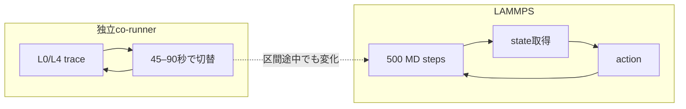

# 2026-10-14 amp2：独立CPU contentionを観測するShock/NEMD RL

凍結paired live評価の結果は[RESULTS.md](RESULTS.md)にまとめた。

## 目的

Shock/NEMDの実行中にCPU contentionが外生的に変化する環境で、contention情報をstateに
含む方策が、情報を持たない方策より適切にbalance actionを選べるか調べる。

比較基準は2026-10-09の
[RL_VS_OFFICIAL_HEURISTICS.md](../2026-10-09_amp2/RL_VS_OFFICIAL_HEURISTICS.md)
である。workload、action、reward、decision interval、episode長、学習量は同じにする。

## 固定条件

| 項目 | 設定 |
|:---|:---|
| workload | Shock/NEMD、491,520 atoms |
| MPI / OpenMP | 32 ranks / 1 thread per rank |
| backend | CPU/MPI |
| skin | 0.5固定 |
| decision interval | 500 MD steps |
| episode | 120 decisions = 60,000 MD steps |
| 初期化 | factor 1.5によるinitial balance + 50-step warm-up |
| action | skip、または`weight neigh factor in [0.5,1.5]` |
| reward | `-(balance適用時間 + 500-step実行時間)` |
| training | 48 episodes：20 exploration + 28 online FQI |

## 外乱

- L0：co-runner duty cycle 0%
- L4：logical CPUs 0–7上の8 workersが100% duty
- block長：一様分布45–90 wall-clock seconds
- 開始levelと各block長はseed付き乱数で決める

co-runnerはLAMMPS controllerとは別processで`time.monotonic()`に従って動く。contentionは
decision boundary、MD step、balance actionと同期しない。500-step区間の途中でも切り替わる。
controllerはcontention切替のためにsleepせず、実行時間を人為的に変更しない。



## State

2026-10-09のprogress-free 19要素を維持する。

- temperature、pressure、atom imbalance、現在factor
- balance履歴とbalance前後のatom imbalance
- Pair、Neigh、Comm、Modify時間/step
- neighbor build率、`Nlocal`・neighbor不均衡
- x方向subdomain幅のmin/max/std

contention-aware方策だけ、直前実行区間のOS累積counterから次の3要素を追加する。

1. cores 0–7のCPU utilization mean
2. cores 0–7のCPU utilization max
3. cores 0–7のCPU utilization std

preflightでは純L0区間のmeanが23.5% ± 11.7%、純L4区間が100.0% ± 0.0%となり、
明確に分離した。LAMMPS CPU entitlementも診断ログへ保存するが、L0/L4とも約1.001で
情報を持たなかったため方策入力から除外した。

方策へはground-truth L0/L4、schedule phase、残り時間、未来のlevel、step、decision番号、
shock位置、履歴を渡さない。

## 観測方法

観測待ち時間は設けない。各500-step区間の前後で以下の累積counterを読む。

- per-core CPU time
- LAMMPS MPI process treeのCPU time

差分からresource stateを計算し、次のaction選択に使う。最初のactionではinitial balanceと
50-step warm-up区間のcounter差分を使用する。

各transitionには、解析専用として区間内のL0/L4滞在秒数も保存する。

## Clean baseline guardと外部process監視

各episodeのLAMMPS/co-runner起動前に5秒のCPU測定を行い、次の条件を2窓連続で満たすまで
開始しない。

- CPU 0–7 utilization mean <= 15%
- CPU 0–7 utilization max <= 50%
- machine-wide CPU utilization mean <= 15%
- 1-minute load average <= 8

最大30分待っても満たさなければ、そのepisodeを開始せず実験を停止する。各試行の判定値と
上位CPU使用processは`baseline_guard.json`へ保存する。またepisode実行中も5秒間隔で、
CPU 0–7、machine-wide utilization、load average、上位20 processのPID・command・CPU使用率・
study processか否かを`host_process_monitor.jsonl`へ記録する。これは診断用でありrewardには
含めない。

## 比較する学習方策

### Contention-aware

既存19要素とresource 3要素を使う22観測変数の方策。実装上は回帰の定数項1つを加えた
23要素のstate vectorとなる。

### Contention-blind baseline

今回と同じ独立wall-clock L0/L4環境で48 episodes学習する。aware方策との違いは、CPU
utilization mean/max/stdの3観測を入力から除くことだけである。物理seed、探索action列、
contention schedule seed、episode数、更新頻度をaware方策と一致させ、resource観測の効果を
調べる主たるmatched baselineとする。

2026-10-09に学習済みの`RL-contention`は、同じ19観測変数、workload、action、reward、
学習量を用いるが、L0/L4を2–5 decisionsで切り替えた方策である。これは新しいschedule上で
凍結再評価するものの、matched baselineではなく補助比較として扱う。

## 凍結後の比較方策

1. New matched contention-aware RL
2. New matched contention-blind RL
3. 2026-10-09 RL-idle（補助比較）
4. 2026-10-09 RL-contention（補助比較）
5. 固定neighbor factor 0.8
6. 固定neighbor factor 1.0

既存方策も新しい独立wall-clock schedule上で再実行する。過去レポートの値との単純な
差ではなく、同一の未見traceと物理初期状態によるpaired comparisonを主結果とする。

## 評価条件

- physical seed：47287、57287
- 各seed 2反復
- 各方策`n=4`
- 全方策で同じ未見schedule seed
- 120 decisions/episode
- policy parametersは凍結し、探索・online updateなし

主指標はepisodeのapplication wall timeである。sampler/control overheadを含むend-to-end timeも
併記する。paired 95% confidence intervalを計算し、差が測定変動に近ければ評価のみ`n=8`
以上へ増やす。

## 成功条件

1. resource観測がL0/L4または区間内L4比率と対応する。
2. aware方策のaction分布がresource状態によって変わる。
3. aware方策が同じ環境・学習量のmatched blind方策よりepisode総時間を短縮する。
4. 改善がpaired uncertaintyより大きい。
5. dangerous build、NaN/Inf、crashがない。

actionが変化してもwall timeが改善しなければ、「外乱識別は可能だが制御価値は未確認」とする。

## 実行順序

1. co-runner単体テスト
2. resource観測のL0/L4分離preflight
3. 数decisionのLAMMPS dry run
4. contention-aware 48 episodes
5. contention-blind 48 episodes
6. dataset・安全性監査
7. frozen-policy paired evaluation
8. 結果解析と本ディレクトリへの追記

## Preflight結果

本学習前に、短周期の機能試験と45–60秒blockの信号試験を実行した。

| 確認項目 | 結果 |
|:---|:---|
| 完了episodes / transitions | 4 / 18 |
| 500-step整合性 | 全transitionで正常 |
| 区間途中のL0/L4切替 | 確認済み |
| dangerous builds | 0 |
| crash / NaN / Inf | 0 |
| 残留MPI/co-runner process | 0 |
| 純L0 target util mean | 23.5% ± 11.7%、n=6 |
| 純L4 target util mean | 100.0% ± 0.0%、n=5 |
| LAMMPS CPU entitlement | L0/L4とも約1.001、識別情報なし |

この結果から、方策入力にはCPU utilization mean/max/stdを採用し、entitlementは診断ログに
のみ残した。短周期試験では全6 transitionがL0/L4混在区間となり、外乱がdecisionから独立に
切り替わることも確認した。

## 本学習

2026-10-14に以下を逐次実行開始した。

```text
contention-aware: 48 episodes
contention-blind: 48 episodes
```

両方を同じ設定で学習する。2026-10-09の凍結済み方策は補助baselineとして使う。

最初のaware 48-episode runは計算自体は完了したが、純L0区間でもCPU 0–7 utilizationが
99.4%（純L4 99.8%）であり、意図しない外部負荷を受けていた。比較datasetから除外して
`shock_balance_contention_aware_v1-invalid-high-l0-20261016`へ隔離した。blind runでは純L0
20.8%、純L4 94.3%であり、こちらは温存する。上記guardとmonitorを追加したうえでawareのみ
再学習する。

各episode完了時に`progress.json`とpolicy checkpointを更新する。中断時は未完了episodeを
隔離し、最後に完了したepisodeから再開する。

## 実装

- `rl_hpc/characterization/shock/cpu_contention_clock.py`
- `rl_hpc/characterization/shock/cpu_resource_observer.py`
- `rl_hpc/characterization/shock/cpu_host_monitor.py`
- `rl_hpc/characterization/shock/online_balance_contention.py`
- `rl_hpc/characterization/shock/run_contention_aware_study.py`

生成dataset、log、checkpointは`rl_hpc/characterization/data/`以下に保存し、gitへは追加しない。

## 2026-10-17 再学習完了状況

clean baseline guard追加後のaware再学習と、先に取得したblind学習はともに48 episodes、
5,760 transitionsを完了した。

| 項目 | aware | blind |
|:---|---:|---:|
| episodes | 48 | 48 |
| transitions | 5,760 | 5,760 |
| model updates | 169 | 169 |
| 純L0 CPU 0–7 utilization mean | 20.65% | 20.84% |
| 純L4 CPU 0–7 utilization mean | 94.42% | 94.33% |
| 最終8 training episodesの平均reward | -889.64 s | -894.82 s |
| dangerous / unsafe / failure | 0 / 0 / 0 | 0 / 0 / 0 |

awareの48 episode開始前guardは全て合格した。guard通過時のCPU 0–7 utilization meanは
平均0.012%、最大0.125%であり、実行中8,999 monitoring samplesにもstudy外の1%以上CPU
processは記録されなかった。したがって、今回のaware/blindは少なくとも生成したL0/L4強度と
開始時host状態について比較可能である。

training rewardにはepsilon探索が残り、両方を同時刻に実行したpaired評価でもないため、上表の
約5.18秒（約0.58%）差を方策優位性とは解釈しない。次工程は、両方のcheckpointを凍結し、
同一の未見physical seedとwall-clock contention scheduleでlive paired evaluationを行うことである。
