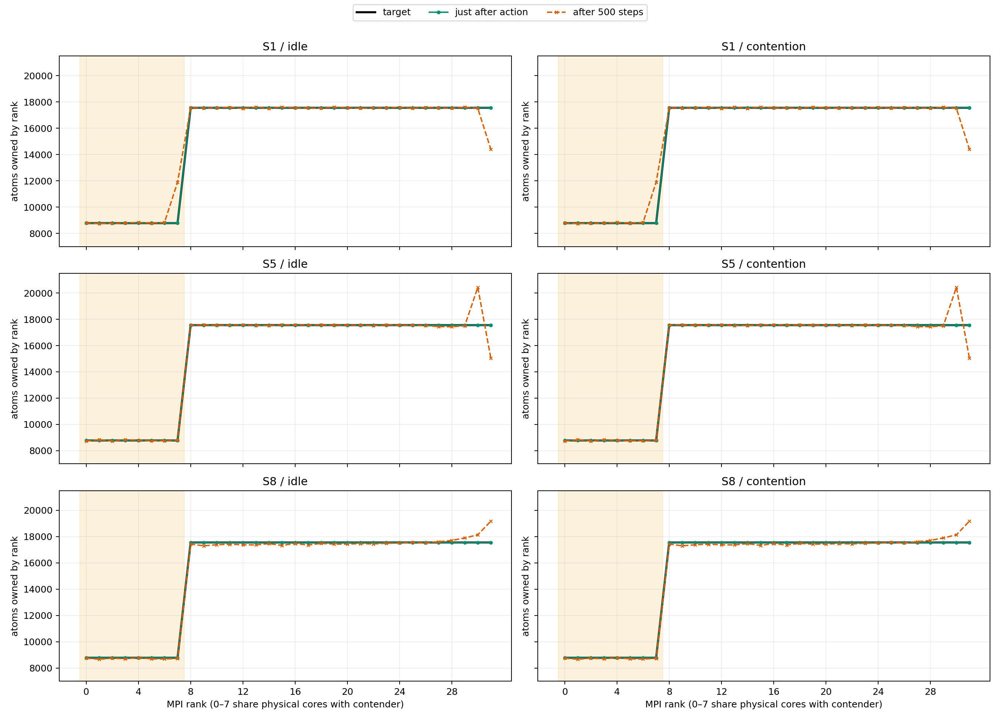
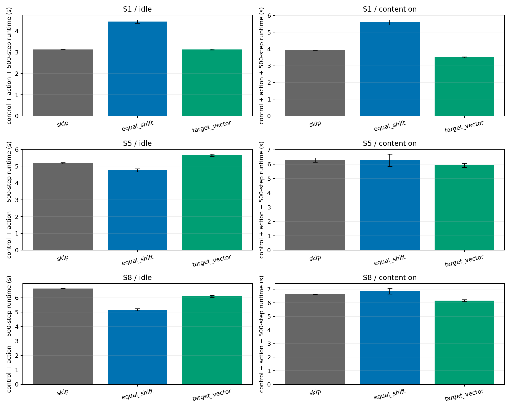

# Shock/NEMD: rank別目標負荷ベクトルによるx領域分割

## 結論

CPU coreとMPI rankの対応を固定した上で、rank別の目標原子数に沿うx領域分割を、LAMMPS既存の`balance x`で実現した。32 rank中0–7の目標を他rankの半分にした場合、491,520原子の割当目標はそれぞれ約8,777、17,554原子となる。3つのShock状態のすべてで、適用直後の最大相対誤差は0.0131%以下だった。したがって、**特定rankだけ担当原子数を減らすことは可能**である。

CPU contention下での制御時間込みの500-step実行時間は、`skip`比でS1が10.9%、S5が5.9%、S8が7.1%短かった。ただしidleのS5では9.1%遅い。目標原子数に到達することと、常に最速になることは異なる。また、Shockに伴う原子移動により、500 step後の最大相対誤差は状態によって9.3–35.5%に広がる。今回の方式は各判断点で再適用する単発actionであり、500 stepにわたる厳密な割当維持を実証したものではない。

## アルゴリズム

actionを正の32要素ベクトル\(c=(c_0,\ldots,c_{31})\)とする。今回はCPU contentionを掛ける物理core 0–7上のrankに\(c_i=0.5\)、他に\(c_i=1\)を指定した。原子数を負荷指標とすると、総原子数\(N\)に対して各rankの目標は

\[
N_i^*=N\frac{c_i}{\sum_j c_j},\qquad
C_k^*=\sum_{i=0}^{k-1}N_i^*\quad(k=1,\ldots,31).
\]

原子のx座標の累積分布から\(C_k^*\)に最も近い境界を求め、31個の境界を`balance 0.0 x <cuts>`へ渡す。格子面上の原子を分割できない場合は最も近い面間に境界を置く。隣接境界がneighbor skin 0.5より近ければ、安全のためactionを拒否する。これはLAMMPSの`balance shift x`が用いる「累積負荷の目標に向けて境界を動かす」発想を、等間隔の目標からrank別目標に一般化したものである。LAMMPS本体と既存のbalance実装は変更していない。[LAMMPS balance仕様](https://docs.lammps.org/balance.html)

現在の実装は**原子数指標のみ**を実装・評価した。近傍数や時間を指標にするには、その指標の原子別重みと、移動後の計算コスト予測を追加して同じ累積目標を解く必要がある。今回の\(c_i=0.5\)は例示された「担当量を半分」に対応する仮説的actionであり、測定したCPU処理能力から最適化した値ではない。

## 実行環境・プロトコル

- Host `ampb.g2.gsic.titech.ac.jp`、Linux 7.0.0-38、Intel Xeon 6972P、2 socket × 96物理core、2 SMT/core、6 NUMA node、メモリ約1.5 TiB。
- MPI 32、OMP 1。Open MPI 5.0.10の`--nooversubscribe --map-by core --bind-to core`で、rank \(i=0,\ldots,31\)のaffinityはCPU \(i\)とそのSMT sibling \(i+192\)だった。32 rankは異なる32物理coreを占有した。CPU contenderは既存の`cpu_jitter.py`を使用し、論理CPU 0–7に各1 workerを固定した。rankは同じ物理coreのSMT sibling上へ移る可能性があるため、contentionの強度はcore完全固定より弱い可能性がある。
- 既存CPU binary `build_shock_char/lmp`。CMake cacheは`Release`、`BUILD_MPI=ON`、`BUILD_OMP=ON`、`PKG_SHOCK=ON`、`PKG_EXTRA-PAIR=ON`、GCC 15.2.0、CMake 4.2.3。Git HEAD `e3d3a52dd043c917b117664224760aa45a727d3d`。本調査ではLAMMPSを再ビルドしていない。
- 固定seed 47287由来の既存Shock checkpoint S1(step 4800)、S5(step 35800)、S8(step 57300)を使用。各試行は独立processで同じcheckpointを読み、`processors 32 1 1 map xyz`、共通の`balance 1.0 shift x 10 1.0 weight neigh 1.0`、50-step warmupの後にactionを適用した。skin 0.5、測定500 MD steps。restartのSHA-256は[metrics.json](metrics.json)に記録した。
- 比較actionは`skip`、既存の単発`balance 1.0 shift x 10 1.0`、rank別目標ベクトル方式。idle/contentionを各3反復、合計54試行を固定seedでランダム順・逐次実行した。比較対象の単発`shift x`は公式の周期的`fix balance 500 1.2 ...`とは異なる。
- 計測の主指標は「原子座標の取得・境界計算＋balance適用＋500-step LAMMPS実行」。共通restart読込・50-step warmup、診断用の適用後/終了後dump、process起動時間は含めない。`skip`と`shift x`に不要な座標取得は、それらの計測時間に含めない。[runtime_summary.csv](runtime_summary.csv)にはLAMMPS内時間と制御時間も別々に載せた。

## 目標追従

| 状態 | 適用直後の最大相対誤差 | 500 step後の最大相対誤差 |
|:--|--:|--:|
| S1 | 0.0098% | 35.51% |
| S5 | 0.0130% | 16.39% |
| S8 | 0.0130% | 9.27% |

誤差は\(\max_i |N_i-N_i^*|/N_i^*\)。同じcheckpointと同じ原子軌跡からのため、idle/contentionで原子数の推移は一致した。S1の500-step後の最大誤差は主に領域端のrankで生じており、全rank平均絶対誤差は約221原子である。個々のrankと試行の値は[rank_counts.csv](rank_counts.csv)で確認できる。

## 実行時間

値は制御時間を含む平均±標本標準偏差（秒、各n=3）。

| 状態 | 条件 | skip | 既存equal shift | rank別目標 |
|:--|:--|--:|--:|--:|
| S1 | idle | 3.124±0.006 | 4.442±0.078 | 3.127±0.023 |
| S1 | contention | 3.937±0.011 | 5.594±0.148 | **3.508±0.025** |
| S5 | idle | 5.182±0.030 | **4.761±0.087** | 5.655±0.072 |
| S5 | contention | 6.288±0.155 | 6.274±0.430 | **5.919±0.140** |
| S8 | idle | 6.641±0.016 | **5.170±0.072** | 6.103±0.065 |
| S8 | contention | 6.636±0.014 | 6.856±0.214 | **6.167±0.071** |

目標ベクトル方式の座標取得と境界計算は平均約0.27–0.29秒。これを除いたLAMMPS内時間だけの比較は[runtime_comparison.png](runtime_comparison.png)に示す。S1 idleではLAMMPS内時間は短縮したが、制御時間込みでは`skip`と同等になった。S5 idleでは既存の均等化が最速だった。contention下の`skip`との差はS1で0.429秒、S5で0.369秒、S8で0.469秒（3反復のpaired平均）。各状態の3 paired差はすべて同じ符号だったが、反復数は3なので一般化性能の推定ではない。

## 安全性と制約

主評価54/54試行がreturn code 0。全試行で491,520原子、step増分500、dangerous neighbor builds 0、有限の状態値・時間値を確認した。unsafe transition、LAMMPS/MPI errorはなく、終了後に残留LAMMPS/MPI processはなかった。原子座標dumpは読取後に削除し、restart、LAMMPS log、raw JSONL、binaryをGitへ追加していない。

今回の結果は3 checkpointからの**単発500-step fork評価**であり、長いShock軌跡全体に対するオンライン方策の性能ではない。目標ベクトルは固定で、contention強度の観測やCPU能力の推定を行っていない。500-step後の目標逸脱を小さくするには、次の制御区間で境界を再計算するか、より短い更新間隔を評価する必要がある。また、`32×1×1`のx方向スラブ分割に限定しているため、3D分割や通信費の異なるワークロードにはそのまま拡張できない。

実装は[rank_target_balance.py](../../../characterization/shock/rank_target_balance.py)、検証・作図は[analyze_rank_target_balance.py](../../../characterization/shock/analyze_rank_target_balance.py)。生データはGit ignore下の`rl_hpc/characterization/data/rank_target_balance_eval_v2/`に保存した。
