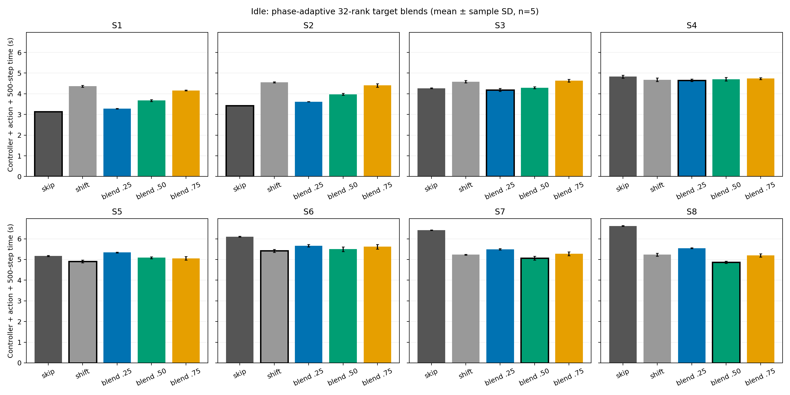

# ampb: 32 rank別目標ベクトルの追加最適化（idle）

> **比較上の訂正:** このページの`equal_shift`はLAMMPS内蔵の別アルゴリズムであり、rank別x境界アルゴリズムによる「原子数を完全に均等化した場合」の対照ではない。したがって、下記の`blend_0.50`対`equal_shift`の差だけから、同一アルゴリズム内で不均等割当が均等割当より優れるとは結論できない。同一アルゴリズムの`blend_1.00`を含めた[追加比較](SAME_ALGORITHM_UNIFORM_COMPARISON.md)を主な根拠とする。

## 結論

先頭8 rankを同じ係数で動かした[前回の掃引](RESULTS.md)では、S1以外のrank目標actionは`target_1.00`が最速だった。しかしこれはその5候補の中だけの結論だった。**32 rankそれぞれの既存割当を使った中間目標ベクトル**を追加評価すると、S7・S8では`blend_0.50`が同時期測定の既存`equal_shift`より速かった。S8は制御時間込みで4.866±0.056秒対5.234±0.070秒、差0.368秒（7.0%）だった。5反復すべてで`blend_0.50`が速い。S7は5.070±0.091秒対5.232±0.023秒、差0.162秒（3.1%）で、こちらも5反復すべて同じ符号だった。

したがって、**rank別の不均等な担当原子数が、idleの後半Shock phaseでも均等化より速い場合がある。** S7・S8では`blend_0.50`の適用直後に最大約30,241・32,576原子を持つrankがある一方、均等shiftは約15,432・15,459原子まで揃える。それでも計算・通信の実測時間は中間ベクトルの方が短い。これは「原子数の均等」と「実負荷の均等」が異なることを示す。

## 候補ベクトルと測定

各checkpointの共通pre-action `weight neigh 1.0`分割後のrank別原子数を \(N_i^{(0)}\) とし、総原子数491,520の均等目標を \(\bar N=15,360\) とする。今回は

\[
N_i^*(\lambda)=(1-\lambda)N_i^{(0)}+\lambda\bar N,
\qquad \lambda\in\{0.25,0.50,0.75\}
\]

を32要素の目標ベクトルとした。\(\lambda=0\)なら元の分割、\(\lambda=1\)なら全rankの原子数均等化に相当する。既存の[rank-target x境界制御](../../../characterization/shock/rank_target_balance.py)でこの目標から31個のx境界を求め、`balance 0.0 x`へ渡す。新しいLAMMPS方策や学習モデルは導入していない。元の分割を保つ`skip`と既存`equal_shift`を同時期の対照として測定した。

環境は前回と同じ`ampb`、MPI32/OMP1、491,520 atoms、skin 0.5、CPU contentionなし。8つの既存checkpointをSHA-256照合し、独立processごとに共通のneighbor-weight partitionを再構成、50-step warmup後にactionを1回適用し、500 MD stepsを測定した。8状態×5 action×5反復＝200件を固定seedでランダム順・逐次実行した。主指標はcontrollerの座標取得・境界計算、balance適用、500-step MDの合計である。共通checkpoint読込・warmup、診断dump、process起動は含めない。

## Runtime matrix

秒、平均±標本標準偏差（各n=5）。太字は今回の5候補の中で平均最速。

| 状態 | skip | equal shift | blend 0.25 | blend 0.50 | blend 0.75 |
|:--|--:|--:|--:|--:|--:|
| S1 | **3.135±0.019** | 4.363±0.045 | 3.280±0.014 | 3.674±0.041 | 4.162±0.016 |
| S2 | **3.428±0.017** | 4.555±0.030 | 3.619±0.013 | 3.976±0.045 | 4.407±0.086 |
| S3 | 4.267±0.017 | 4.585±0.056 | **4.188±0.076** | 4.292±0.045 | 4.636±0.065 |
| S4 | 4.828±0.074 | 4.677±0.085 | **4.654±0.057** | 4.703±0.085 | 4.737±0.046 |
| S5 | 5.171±0.025 | **4.907±0.067** | 5.341±0.021 | 5.087±0.048 | 5.058±0.088 |
| S6 | 6.104±0.023 | **5.421±0.074** | 5.665±0.062 | 5.498±0.109 | 5.619±0.111 |
| S7 | 6.419±0.009 | 5.232±0.023 | 5.495±0.032 | **5.070±0.091** | 5.281±0.092 |
| S8 | 6.621±0.020 | 5.234±0.070 | 5.547±0.021 | **4.866±0.056** | 5.197±0.075 |

各actionのmean、std、CV、5つの測定値、controller/MD時間の内訳は[CSV](rank_target_blend_matrix.csv)と[summary JSON](rank_target_blend_summary.json)に保存した。S3で`blend_0.25`が`skip`より0.079秒、S4で`equal_shift`より0.023秒速いという平均差は反復ばらつきと同程度で、確かな改善とは言いにくい。S7・S8の差は大きく、S7の反復ごとの`shift`との差は0.023〜0.273秒、S8は0.275〜0.541秒で、すべて正だった。

## なぜ速くなったか、計算費用の扱い

`shift`の優位には、LAMMPS内で境界を求める処理が速いことも含まれる。今回の中間ベクトルでは、原子座標をdumpしてx累積分布から境界を求める外部controllerに平均約0.26〜0.28秒かかる。`equal_shift`のbalance適用は約0.007〜0.013秒である。この費用を無視してMD時間だけを比べてはいけない。

S8の`blend_0.50`は、この約0.28秒の費用を払っても勝った。500-step MD部分は4.581秒、`equal_shift`は5.221秒で、MDで0.640秒短縮し、controller費用込みで0.368秒の改善が残った。S7もMD部分が4.789秒対5.221秒で、controller費用込み0.162秒速い。

LAMMPSのrank間タイミング集約でも、S8の`blend_0.50`対`equal_shift`は、Pair最大時間2.505対2.890秒、Neigh最大時間1.767対2.002秒、Comm最大時間0.426対1.301秒だった。S7もPair最大2.876対3.131秒、Neigh最大1.621対1.766秒、Comm最大0.682対1.272秒だった。原子数を均等化しすぎず、元のneighbor-weight分割を一部保持した方が実負荷のボトルネックを小さくした、と解釈できる。ただし集約タイミングだけでは特定rankの因果寄与までは確定できない。

### 「負荷均等」の意味

原子数不均衡を \(I_N=\max_i N_i/(491520/32)\)、Pair・Neigh時間のrank間不均衡をそれぞれ`max/avg`で比較すると次の通り（5反復平均）。原子数はaction適用直後、タイミングは後続500 stepsの値である。

| 状態 | action | 原子数 \(I_N\) | Pair時間 max/avg | Neigh時間 max/avg | 総時間 (秒) |
|:--|:--|--:|--:|--:|--:|
| S1 | skip | 1.182 | 1.176 | 1.183 | **3.135** |
| S1 | equal shift | 1.004 | 1.723 | 1.592 | 4.363 |
| S2 | skip | 1.381 | 1.150 | 1.090 | **3.428** |
| S2 | equal shift | 1.006 | 1.563 | 1.471 | 4.555 |
| S7 | blend 0.50 | 1.969 | 1.160 | 1.074 | **5.070** |
| S7 | equal shift | 1.005 | 1.259 | 1.172 | 5.232 |
| S8 | blend 0.50 | 2.121 | 1.168 | 1.072 | **4.866** |
| S8 | equal shift | 1.006 | 1.345 | 1.219 | 5.234 |

したがって、**担当原子数の均等化はidleでも最適とは限らない**。S1・S2・S7・S8では原子数を不均等にした候補が速く、Pair・Neighのrank間最大/平均比も小さい。これは「計算負荷そのものを不均等にするべき」という証拠ではなく、原子1個当たりの仕事量がx位置やphaseで違うため、**原子数を不均等にして計算負荷を均す**方向が有利だったと解釈するのが適切である。MPI通信や時間変動も総時間に影響するため、Pair・Neigh比だけで総負荷の完全な均等性は証明できない。

8状態の各平均を足す仮想総時間では、今回のBest Fixedは`blend_0.50`の37.166秒、同時期の固定`equal_shift`は38.975秒で、差1.809秒（4.64%）。同じデータで各状態の最速を選ぶ**記述的oracle**は35.668秒で、Best Fixedとの差は1.498秒（4.03%）。これは同じ8 checkpointで選択・評価した記述値であり、学習済み方策の性能や不偏な汎化評価ではない。

## 安全性と範囲

事前smoke 4/4件、本測定200/200件がMPI return code 0。全試行で491,520原子、500-step増分、dangerous neighbor builds 0、有限の状態・時間値を確認した。中間ベクトル120件の適用直後の目標原子数最大相対誤差は0.0223%以下。残留MPI/LAMMPS processは0。生データ、restart、dump、log、binaryはGit ignore下の`rl_hpc/characterization/data/rank_target_blend_idle_v1/`に保存し、Gitへ追加していない。

今回の3つの\(\lambda\)も候補を限定した探索であり、32次元の大域最適解は主張しない。S7・S8で見つけた改善は同じcheckpointで候補を選び、同じデータで評価した結果なので、独立した別軌跡・別seedでの再現性は未検証である。実行は[測定スクリプト](../../../characterization/shock/sweep_rank_target_blend.py)、集計は[解析スクリプト](../../../characterization/shock/analyze_rank_target_blend.py)を使用した。
