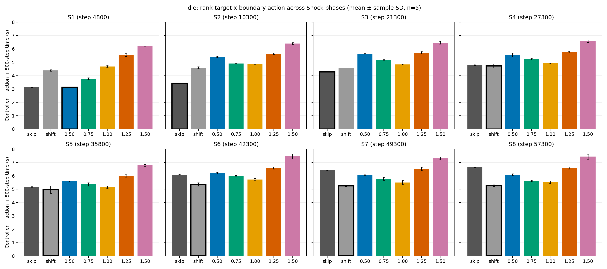
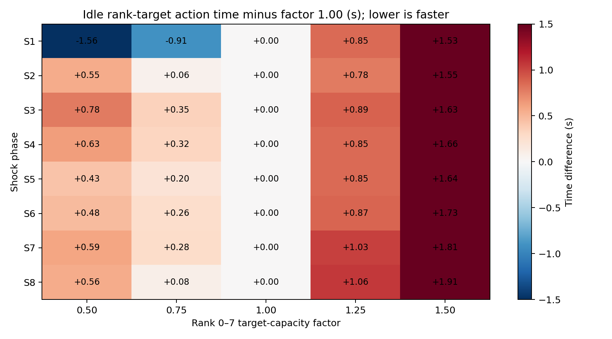

# ampb: idle時のrank別x領域目標actionとShock phase

> **追加結果:** このページの`target_1.00`最速という記述は、先頭8 rankを一括で変えた5候補の中での順位である。32 rankそれぞれの目標を元の分割から調整する[追加評価](RANK_VECTOR_OPTIMIZATION.md)では、S7・S8で不均等な中間ベクトルが均等shiftより速かった。

> **同一アルゴリズムの結論:** `shift`との比較では原子数均等・不均等の効果を分離できない。4つの`blend` actionをすべて同じrank-target `balance x`実装で比較した[対照実験](SAME_ALGORITHM_UNIFORM_COMPARISON.md)を、この問いへの主結果とする。

## 結論

**rank別目標actionの最速係数はphaseで変わった。** 8つの既存checkpointからの独立した500-step評価では、rank 0–7の目標原子数係数はS1で`0.50`、S2–S8で`1.00`が最速だった。S1で`0.50`が`1.00`より1.560秒速い一方、S2では逆に`1.00`が`0.50`より0.551秒速く、各actionの5反復の標本標準偏差（S1: 0.007/0.064秒、S2: 0.053/0.030秒）より大きい。したがって、この2係数間のaction reversalは測定ばらつきだけでは説明しにくい。

ただし、`skip`とLAMMPS既存の単発`shift x`を選択肢に含めると、rank別目標actionが明確に最速となるphaseはない。S1は`target_0.50`と`skip`の差が0.001秒で実質同等、S2–S3は`skip`、S4–S8は`equal_shift`が平均最速だった。後半のphaseで`target_1.00`が既存shiftより遅いのは、原子座標の取得・境界計算に約0.3秒かかることも一因である。この結果は、rank別負荷制御の**最適目標はphase依存**であるが、今回のidle条件で既存actionより優れた方策を示したものではない、という範囲に限る。

## 条件とaction

- Host `ampb.g2.gsic.titech.ac.jp`、Intel Xeon 6972P、2 socket × 96物理core、2 SMT/core、6 NUMA、約1.5 TiB RAM。既存CPU `build_shock_char/lmp`（Release、MPI/OMP/SHOCK/EXTRA-PAIR有効、GCC 15.2.0、CMake 4.2.3、Open MPI 5.0.10）を使用。ソースHEAD `982d0e384366fa189c908debda2d22d196accf81`。この実験ではビルドとLAMMPS本体を変更していない。
- 2026-10-08 ampbの固定seed 47287由来の8 checkpoint（S1–S8、step 4,800/10,300/21,300/27,300/35,800/42,300/49,300/57,300）をSHA-256で照合。MPI 32、OMP 1、491,520 atoms、skin 0.5、`processors 32 1 1 map xyz`。rankごとに異なる物理coreへbindされ、oversubscribeなし。外部CPU/GPU contentionを投入していない。
- 各独立processでcheckpointを読み、共通の`balance 1.0 shift x 10 1.0 weight neigh 1.0`と50-step warmup後にactionを1回適用し、500 MD stepsを測定。binary restartが不均等境界を保存しないため、この共通pre-action partition再構成は必須である。
- `target_f`はrank 0–7に容量係数`f`、rank 8–31に1.0を与え、目標原子数 \(N_i^*=491520c_i/\sum_j c_j\) に合わせてx方向境界を`balance 0.0 x`で指定する。`f`は0.50、0.75、1.00、1.25、1.50。比較用の`skip`と、単発`balance 1.0 shift x 10 1.0`（`equal_shift`）も測定。これは周期的な公式`fix balance`とは別のactionである。
- 8状態×7 action×5回＝280試行を固定seedでランダム順・逐次実行。時間は「controllerの原子座標取得・境界計算＋balance適用＋500-step LAMMPS」の和。共通restart読込と50-step warmup、診断dump、process起動時間は含めない。`skip`と`equal_shift`には不要な座標取得は計上しない。

## 完全なruntime matrix

単位は秒、平均±標本標準偏差（各n=5）。太字は7 action中の平均最速。`target`の数値はrank 0–7の容量係数であり、neighbor重みfactorではない。

| 状態 | skip | equal shift | target 0.50 | target 0.75 | target 1.00 | target 1.25 | target 1.50 |
|:--|--:|--:|--:|--:|--:|--:|--:|
| S1 | 3.129±0.006 | 4.383±0.054 | **3.128±0.007** | 3.775±0.070 | 4.688±0.064 | 5.539±0.102 | 6.222±0.064 |
| S2 | **3.422±0.009** | 4.597±0.073 | 5.401±0.053 | 4.910±0.022 | 4.850±0.030 | 5.629±0.053 | 6.402±0.064 |
| S3 | **4.282±0.018** | 4.576±0.071 | 5.611±0.065 | 5.177±0.019 | 4.831±0.026 | 5.719±0.081 | 6.464±0.110 |
| S4 | 4.808±0.049 | **4.729±0.153** | 5.544±0.138 | 5.239±0.049 | 4.918±0.033 | 5.768±0.064 | 6.573±0.088 |
| S5 | 5.173±0.018 | **4.972±0.283** | 5.580±0.046 | 5.354±0.127 | 5.151±0.078 | 5.998±0.096 | 6.786±0.066 |
| S6 | 6.083±0.015 | **5.361±0.129** | 6.202±0.059 | 5.981±0.053 | 5.723±0.084 | 6.591±0.081 | 7.451±0.182 |
| S7 | 6.426±0.021 | **5.251±0.052** | 6.086±0.045 | 5.779±0.114 | 5.499±0.152 | 6.530±0.116 | 7.307±0.102 |
| S8 | 6.634±0.016 | **5.266±0.059** | 6.091±0.072 | 5.615±0.041 | 5.531±0.101 | 6.588±0.087 | 7.441±0.190 |

各actionのmean、std、CV、5つの個別値、controller/action/MDの時間内訳は[compact CSV](rank_target_phase_matrix.csv)に収めた。各状態の最速・次点gapは[summary JSON](rank_target_phase_summary.json)にも記載している。7 action全体でのbest/runner-up gapはS1 0.001秒、S2 1.175秒、S3 0.295秒、S4 0.079秒、S5 0.179秒、S6 0.362秒、S7 0.247秒、S8 0.265秒。S1とS4の順位はばらつきに照らすと慎重に扱うべきである。

rank目標actionだけに限定すると、S1のbestは0.50（次点0.75との差0.647秒）、S2–S8のbestは1.00（次点0.75との差は順に0.060、0.347、0.320、0.203、0.258、0.280、0.084秒）。S2とS8の次点差は比較的小さいが、S1からS2への0.50対1.00の順位逆転は大きい。

先行する[3状態評価](../2026-10-14_ampb/RESULTS.md)のidle結果とも主要な傾向は一致した。たとえばS1の`target_0.50`は今回3.128秒、先行評価3.127秒、S8の`target_0.50`は今回6.091秒、先行評価6.103秒だった。一方、S5の`equal_shift`は今回4.972秒、先行評価4.761秒で、実行時期による変動もある。異なる時期の値より、本実験内でランダム順に測った同一checkpoint・同一action群の比較を主結果とする。

## 集約値と安全性

8 checkpointを各1回ずつ評価する仮想的な総時間（各セルの5反復平均を加算）では、7 action全体のBest Fixedは`equal_shift`の39.136秒。各状態で同じ測定値から最速を選ぶ**記述的state-conditioned oracle**は36.412秒で、差は2.724秒（6.96%）。rank目標actionだけならBest Fixedは`target_1.00`の41.191秒、同じデータ上の記述的oracleは39.631秒で、差は1.560秒（3.79%）。いずれのoracleも同じデータで選択と評価をしており、学習方策や不偏な汎化性能ではない。

本測定280/280、事前smoke 4/4がreturn code 0。全試行で491,520原子、step増分500、dangerous neighbor builds 0、有限の時間・状態値を確認した。target action適用直後のrank別原子数の目標からの最大相対誤差は、全200件で0.0196%以下だった。500 step後は原子移動で最大35.5%まで逸脱し得るため、この検証は**適用直後の割当制御**を示す。測定後の残留MPI/LAMMPS processは0。生restart、dump、log、binary、raw JSONLはGit ignore下の`rl_hpc/characterization/data/rank_target_phase_idle_v1/`に置き、Gitへ追加していない。

実行スクリプトは[こちら](../../../characterization/shock/sweep_rank_target_phases.py)、検証・作図スクリプトは[こちら](../../../characterization/shock/analyze_rank_target_phases.py)。既存のrank境界制御本体は[こちら](../../../characterization/shock/rank_target_balance.py)。
