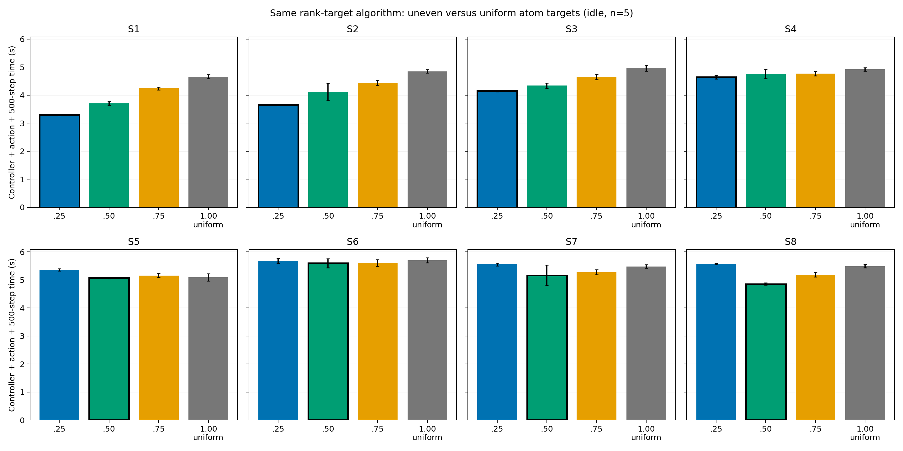

# ampb: 同一rank別x境界アルゴリズム内での原子数均等・不均等の比較

## 問いと結論

**問い:** CPU contentionなしのShock/NEMDで、rankごとの担当原子数を均等にするactionが最速か。phaseによって不均等な目標の方が速いか。

同じrank別x境界アルゴリズムに限定して比較した結果、**均等目標`blend_1.00`は8状態のどれでも平均最速ではなかった。** S1–S4では不均等な`blend_0.25`、S8では不均等な`blend_0.50`が明確に速い。S5・S6の平均差は小さく、S7は平均では`blend_0.50`が速いが反復ばらつきが大きい。候補内の最良actionが序盤の0.25から終盤の0.50へ変わったことは、状態によって分割actionを選ぶ根拠になる。ただしこの8 checkpoint上での候補選択であり、独立軌跡への汎化は未検証である。

## 同一アルゴリズムのaction定義

すべてのactionは同じ[rank-target実装](../../../characterization/shock/rank_target_balance.py)の`target_vector`経路を通り、同じ座標dump・累積分布逆変換・`balance 0.0 x`・500-step計測を行った。LAMMPS内蔵`shift`は**比較に含めていない**。変えたのは32 rankの目標原子数だけである。

共通pre-action partitionのrank \(i\) の原子数を \(N_i^{(0)}\)、均等数を \(\bar N=491520/32=15360\) とし、

\[
N_i^*(\lambda)=(1-\lambda)N_i^{(0)}+\lambda\bar N
\]

を指定した。\(\lambda=0.25,0.50,0.75\)は不均等目標、**\(\lambda=1.00\)は全32 rank各15,360原子への完全な均等目標**である。`blend_1.00`は先行実験の`target_1.00`と同じ目標・同じ実装だが、今回の4 actionを同時期にランダム順で測定し直した。

固定seed 47287由来の既存8 checkpoint、MPI32/OMP1、491,520 atoms、skin 0.5、500 MD steps、CPU contentionなし。各試行は独立processで、同じcheckpointから共通`weight neigh 1.0` partitionを再構成して50-step warmup後にactionを適用した。4 action×8状態×5反復＝160試行を固定seedでランダム順・逐次実行した。時間は外部controllerの座標取得・境界計算、balance適用、500-step MDを含む。共通のrestart読込・warmup、診断dump、process起動は含まない。

## Runtime matrix

秒、平均±標本標準偏差（各n=5）。太字は同一アルゴリズム4候補の平均最速。

| 状態 | 不均等 0.25 | 不均等 0.50 | 不均等 0.75 | **均等 1.00** | 最速の均等比改善 |
|:--|--:|--:|--:|--:|--:|
| S1 (4,800) | **3.295±0.026** | 3.704±0.063 | 4.240±0.051 | 4.659±0.073 | 1.364秒 (29.3%) |
| S2 (10,300) | **3.645±0.018** | 4.115±0.302 | 4.438±0.095 | 4.849±0.061 | 1.204秒 (24.8%) |
| S3 (21,300) | **4.147±0.031** | 4.337±0.094 | 4.649±0.100 | 4.964±0.108 | 0.816秒 (16.4%) |
| S4 (27,300) | **4.645±0.065** | 4.756±0.167 | 4.762±0.078 | 4.918±0.064 | 0.273秒 (5.6%) |
| S5 (35,800) | 5.358±0.040 | **5.070±0.027** | 5.153±0.072 | 5.091±0.132 | 0.021秒 (0.4%) |
| S6 (42,300) | 5.676±0.089 | **5.596±0.164** | 5.606±0.116 | 5.698±0.091 | 0.102秒 (1.8%) |
| S7 (49,300) | 5.551±0.049 | **5.164±0.362** | 5.277±0.091 | 5.481±0.061 | 0.317秒 (5.8%) |
| S8 (57,300) | 5.566±0.025 | **4.856±0.040** | 5.187±0.084 | 5.492±0.059 | 0.636秒 (11.6%) |

[compact CSV](same_algorithm_uniform_matrix.csv)に各actionのmean、std、CV、5つの実測値、controller/action/MD内訳、適用直後の原子数不均衡を保存した。[summary JSON](same_algorithm_uniform_summary.json)には均等目標との差の5反復値を保存した。S1–S4とS8では、最速不均等actionが均等`1.00`より速い差は5反復すべて同じ符号だった。S5は差0.021秒でばらつきより小さい。S6・S7には均等が速い反復もあるため、平均順位を強い証拠としない。

## 原子数不均衡と実計算負荷

適用直後の原子数不均衡 \(I_N=\max_i N_i/15360\) は、均等`1.00`で約1.000、S1の最速`0.25`で1.136、S4の最速`0.25`で1.749、S8の最速`0.50`で2.121だった。目標のrank別原子数への最大相対誤差は全160件で0.0223%以下。

同一アルゴリズムのS8ログでは、`blend_0.50`のrank間Pair時間max/avgが1.172、Neigh時間max/avgが1.071であり、均等`blend_1.00`ではそれぞれ1.343、1.210だった。S1でも最速`0.25`は1.179、1.106、均等`1.00`は1.731、1.598だった。**原子数を不均等にした方が、観測されたPair・Neighbor時間はむしろ均等に近づいた。** したがって「計算負荷そのものを不均等にするべき」とまでは言えず、phaseごとに変わる原子1個当たりの仕事量に合わせて担当原子数を変える、と解釈するのが妥当である。

全actionにほぼ同じ外部controller費用がかかるため、先の`shift`比較にあったアルゴリズム間の制御コスト差は今回の結論に入らない。S8では`0.50`と`1.00`のcontroller費用はそれぞれ平均0.278秒でほぼ同じ、MD部分は4.570秒対5.204秒だった。差は目標ベクトルとその領域分割に起因すると考えられる。

## 集約値・安全性・限界

8状態の各平均を足した仮想総時間では、Best Fixedは`blend_0.50`の37.598秒、均等固定`blend_1.00`は41.150秒で差3.553秒（8.6%）。同じ測定データで各状態の最速を選ぶ記述的oracleは36.418秒で、Best Fixedとの差1.180秒（3.1%）。これは同じcheckpointで選択と評価をした記述値であり、学習方策や不偏な汎化性能ではない。

事前smoke 2/2、本測定160/160がreturn code 0。全試行で491,520原子、500-step増分、dangerous neighbor builds 0、有限の状態・時間値を確認した。測定終了後に残留MPI/LAMMPS processはなかった。raw JSONL、restart、dump、log、binaryはGit ignore下の`rl_hpc/characterization/data/rank_target_same_algorithm_idle_v1/`に置き、Gitへ追加していない。[測定スクリプト](../../../characterization/shock/sweep_rank_target_blend.py)と[解析スクリプト](../../../characterization/shock/analyze_rank_target_uniform.py)を使用した。

今回の候補は4つの一次元blendに限定される。全32要素を独立に最適化した結果ではない。また、8つの固定checkpointの単発forkであり、長い軌跡で状態に応じてactionを切り替える方策の総実行時間、別seedでの再現性は未評価である。
