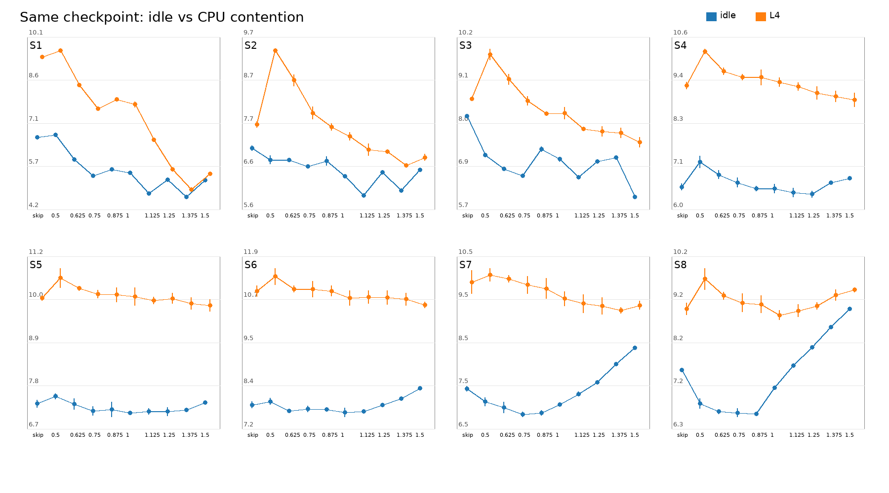
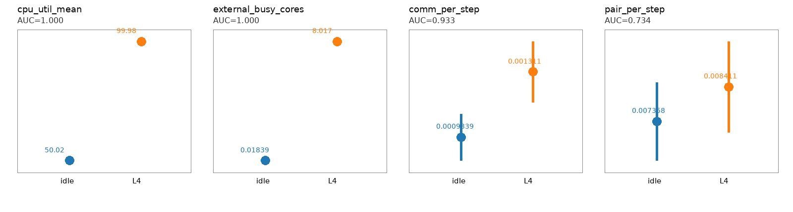

# CPU contention × balance factor反実仮想実験：結果

同一checkpointからidle/L4および10 actionsへ分岐した800試行の結果。各cellは5反復。
CIは反復blockを対応させたdf=4の無補正95% t区間であり、多重比較の同時保証ではない。

## Best action

| State | Idle best | gap (95% CI), s | L4 best | gap (95% CI), s | reversal interaction |
|---:|---:|---:|---:|---:|:---|
| S1 | 1.375 | -0.1099 [-0.1516, -0.0681] | 1.375 | -0.5319 [-0.5760, -0.4878] | same action |
| S2 | 1.125 | -0.1166 [-0.1812, -0.0520] | 1.375 | -0.1964 [-0.2859, -0.1069] | resolved |
| S3 | 1.5 | -0.5008 [-0.5500, -0.4515] | 1.5 | -0.2412 [-0.4985, +0.0161] | same action |
| S4 | 1.25 | -0.0500 [-0.2800, +0.1800] | 1.5 | -0.0923 [-0.3364, +0.1518] | resolved |
| S5 | 1 | -0.0271 [-0.1275, +0.0733] | 1.5 | -0.0508 [-0.1546, +0.0530] | resolved |
| S6 | 1 | -0.0278 [-0.1439, +0.0882] | 1.5 | -0.1643 [-0.3696, +0.0409] | resolved |
| S7 | 0.75 | -0.0386 [-0.1113, +0.0340] | 1.375 | -0.1025 [-0.3492, +0.1443] | resolved |
| S8 | 0.875 | -0.0264 [-0.1769, +0.1241] | 1 | -0.1004 [-0.3696, +0.1688] | resolved |

負のgapはwinnerがrunner-upより速いことを表す。`resolved`は、idle winnerとL4 winnerのdifference-in-differences 95% CIが0を跨がない順位反転。

## 固定actionと記述的oracle

| Regime | Best Fixed | Fixed total, s | State oracle, s | improvement |
|:---|---:|---:|---:|---:|
| idle | 1.125 | 53.4902 | 51.1959 | 4.29% |
| contention | 1.375 | 67.4589 | 66.4578 | 1.48% |

全条件共通Best Fixedはfactor 1.125。内部phaseだけを使うoracleの改善は3.48%、phaseに加えてcontention labelを使う追加改善は1.14%、完全なphase×regime oracleはBest Fixedより4.58%短い。これらは同じデータで選択・評価した記述的上限であり、学習方策の汎化性能ではない。

## Action前telemetry

| Feature | Idle mean | L4 mean | AUC | leave-one-phase-out accuracy |
|:---|---:|---:|---:|---:|
| cpu_util_mean | 50.0153 | 99.9807 | 1.000 | 100.0% |
| cpu_util_max | 100 | 100 | 0.500 | 50.0% |
| cpu_util_std | 45.3009 | 0.0743896 | 1.000 | 100.0% |
| external_busy_cores | 0.0183906 | 8.01673 | 1.000 | 100.0% |
| lammps_cpu_entitlement | 1.00059 | 0.999756 | 0.989 | 95.1% |
| rank_cpu_efficiency_min | 0.996257 | 0.996422 | 0.544 | 52.2% |
| rank_cpu_efficiency_std | 0.000895683 | 0.00066903 | 0.849 | 73.9% |
| involuntary_context_switch_rate | 1.55792 | 1.4912 | 0.704 | 67.2% |
| pair_per_step | 0.00735801 | 0.00841093 | 0.734 | 57.1% |
| neigh_per_step | 0.00302001 | 0.00338556 | 0.616 | 56.2% |
| comm_per_step | 0.000933859 | 0.00131149 | 0.933 | 89.8% |

## 安全性と解釈

- 800/800試行が成功し、probe/action区間ともdangerous buildは0。
- 同一phase内のaction前temperature、pressure、density、energy、shock positionのrangeは記録精度で0。
- CPU utilization meanと外部busy推定はL0/L4を完全分離した。CPU utilization maxは常に100%で無効。
- Comm timeにも強い識別情報があり、従来のBlind方策が外乱を間接観測できた説明と整合する。
- interaction contrastも同じgridからwinnerを選んだ後に評価しているため探索的であり、選択biasを含む。
- S2は両regimeのwinner-runner gapとinteractionがすべて解決しており、現時点で最も強いreversal。
- S4--S8はinteractionは大きいが各regimeの最小点周辺が平坦な場合があり、exact argminの確定には候補actionの独立再測定が必要。
